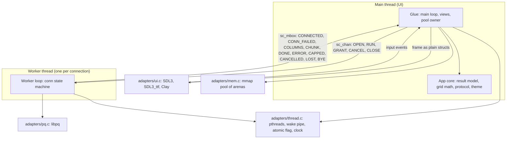
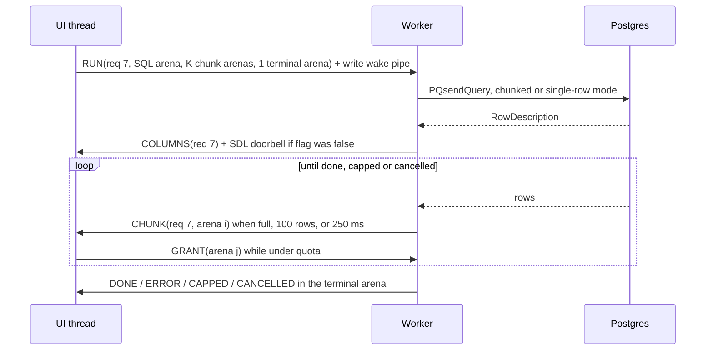
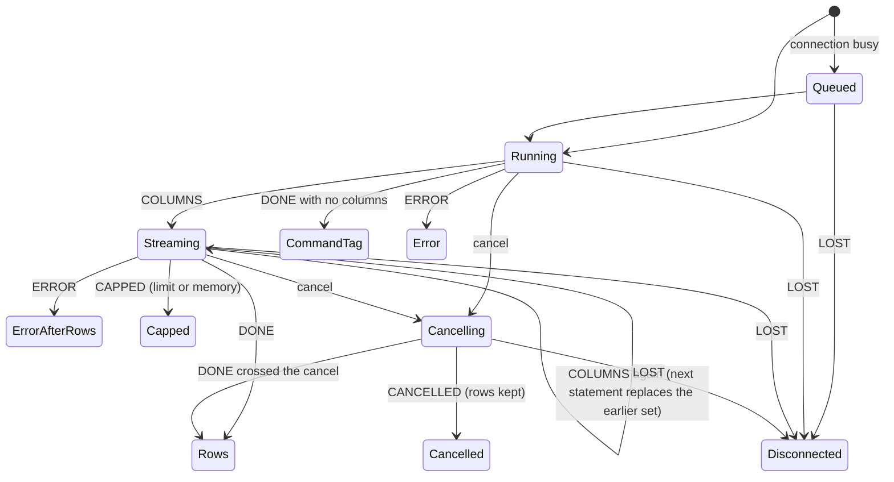
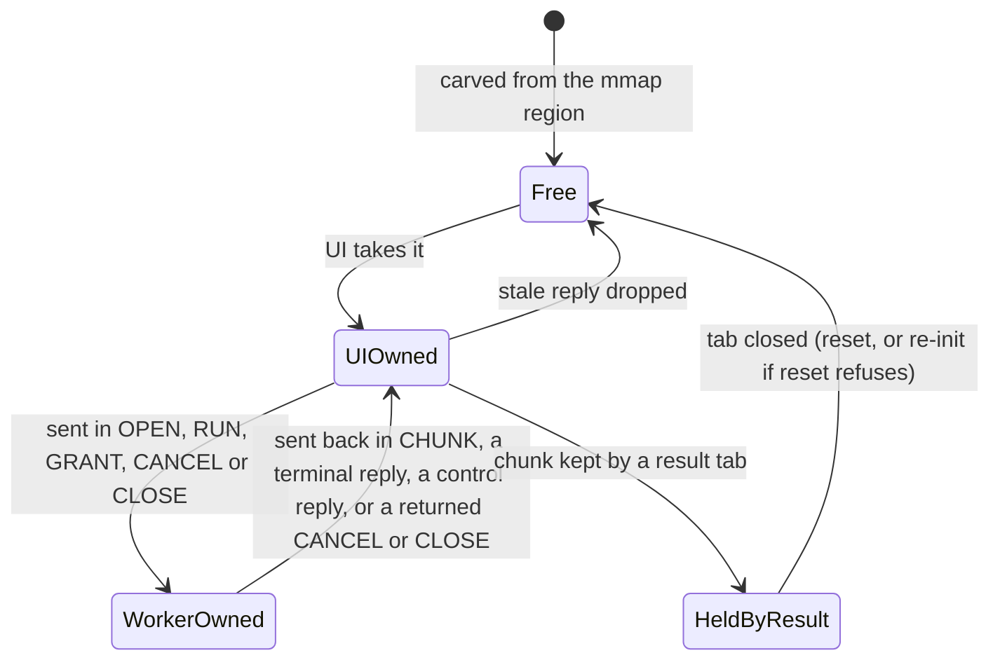
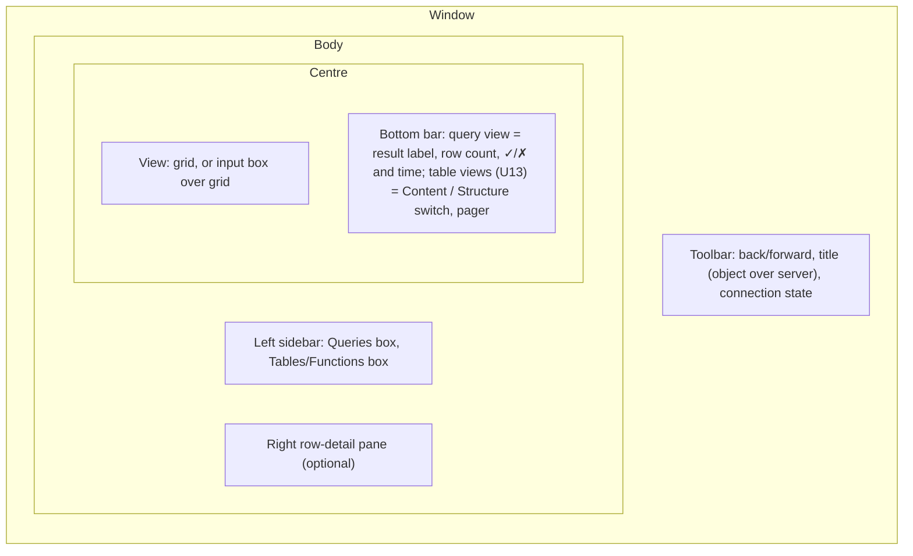

# Postgres Explorer - Plan

## Goal Capsule

- **Objective:** Robert has a Postgres client on his M3 Mac that looks like Postico 2 and that he uses every day once milestone 6 is done. Safe C has a written record of every place the subset, the stdlib or the tooling had to change, or was worked around, to build it.
- **Means:** a new app in `examples/explorer/`, written as subset application code. libpq, SDL3/SDL3_ttf/Clay, pthreads and mmap each sit behind their own adapter (KTD1, KTD2). Generic gaps are fixed in `stdlib/` in the same tree (KTD10).
- **Product authority:** Robert. He owns the subset rules, waivers, and the final visual check on macOS.
- **Execution profile:** one SC-NN stack PR per unit, following `.claude/skills/safe-c-stack-pr/SKILL.md` (KTD16). Agents build, commit, push and open PRs. Robert merges and runs the Mac check at the end of each milestone. Units U1 to U12 (milestones 1 to 3) are implementation-ready. U13 to U15 (milestones 4 to 6) are outlines to re-plan once the milestone 3 breakage log exists.
- **Stop conditions:** stop and ask Robert before you:
  - change a rule in `docs/subset-v1.md` (adding R0 rows is allowed);
  - add a waiver to `waivers.toml`;
  - change the semantics of `stdlib/chan.c` or `stdlib/mailbox.c`;
  - add a third-party dependency beyond libpq, SDL3, SDL3_ttf, Clay and the two bundled fonts.

  Also stop if the thread protocol (KTD5) turns out to need a primitive that only a subset change could express.

---

## Product Contract

### Summary

Build a Postgres explorer in Safe C under `examples/explorer/`, in six milestones that are each usable on their own: a window that draws text, connect and run a query, a result grid that scrolls a million rows, cancel and a schema browser, a SQL editor, and daily-use polish. It copies Postico 2's layout and palette. Next to it sits a breakage log of every Safe C rule fight, missing module or slow path, with what fixed it.

### Problem Frame

Safe C has been tested on small programs. The HTTP demo in `examples/http/` is a few hundred lines with one adapter, and the SC-18 trial only linted someone else's code. Neither shows whether the subset holds up in a program with threads, a GUI, unbounded data and a text editor. The fastest way to find out is to build one that Robert depends on, because a tool used daily surfaces the slow paths and missing pieces that a demo never reaches. Building it in this repo means a gap and its fix land together.

### Requirements

**The app**

- R1. The app builds and runs on macOS on Apple Silicon. The same sources build on Linux, where the app runs headless for tests and screenshots.
- R2. The app connects to a Postgres server from a libpq conninfo string, the `PG*` environment variables, and `~/.pgpass`. Saved connections arrive in milestone 6.
- R3. The app runs SQL and streams the result while the window stays responsive. It renders each outcome distinctly: running, rows, empty result, command tag (`UPDATE 3`), error, error after some rows, cancelled, row limit reached, memory limit reached, and disconnected.
- R4. The result grid scrolls a result of one million rows smoothly on Robert's M3. A row limit is on by default, and the user can lift it.
- R5. The user can cancel a running query (milestone 4).
- R6. A sidebar browses schemas, tables and columns, and a table opens in Content and Structure views (milestone 4).
- R7. A SQL editor with selection, undo and highlighting replaces the plain input box (milestone 5).
- R8. Saved connections, query history, keyboard shortcuts, clipboard and copy as CSV (milestone 6).

**The look**

- R9. The window looks like Postico 2:
  - a left sidebar, a centre view and an optional right detail pane;
  - a grid with faint column lines, alternating rows and a solid blue full-row selection;
  - a bottom bar per view;
  - the Postico light and dark palettes, following the system theme;
  - crisp text on a Retina display.

**Safe C**

- R10. Every file under `examples/explorer/` passes `make lint` under the current subset. A subset change happens only after a breakage log entry and Robert's approval.
- R11. Every call into a C library outside the subset lives in an adapter under `adapters/` with a row in the R0 table of `docs/subset-v1.md`.
- R12. A gap that any app would hit is fixed in this tree. A pure-computation gap becomes a proved stdlib module (contract, blind properties, unit tests, fuzz harness, mutation check). A gap that needs libc becomes an adapter with tests and a fuzz harness.
- R13. Every rule fight, missing module, slow path and workaround gets one entry in the breakage log, with its cost and its resolution.
- R14. `make check` passes after every PR, and no existing check is weakened to make room for the app.

### Key Decisions

- **Postgres through libpq is the only engine.** (session-settled: user-directed — chosen over dbdelve's ten engines: Postgres is Robert's daily database.) Governs R2.
- **The app lives in this repo, under `examples/`.** (session-settled: user-directed — chosen over a separate repo: a Safe C gap and its fix land in the same tree.) Governs R10, R12.
- **The breakage log is the main output besides the app.** (session-settled: user-directed — chosen over treating the app alone as the deliverable: the point is to measure Safe C.) Governs R13.
- **macOS on Apple Silicon is the target Robert runs, and Linux is a build and test target.** (session-settled: user-directed — chosen over macOS-only or both as first-class platforms: Robert uses an M3, and the agents work in Linux orbs.) Governs R1.
- **The look follows Postico 2, as a visual target rather than pixel for pixel.** Robert asked for it when confirming scope. Governs R9.
- **Only milestones 1 to 3 are planned in detail.** (session-settled: user-approved — chosen over planning all six in full: the milestone 3 breakage log will change what milestones 4 to 6 need.) Governs R5–R8.

### Success Criteria

- After milestone 6, Robert uses the app instead of his current client. Earlier milestones end with a check on his Mac, not with daily use.
- After milestone 3, the app connects to Robert's own database on his Mac, runs read-only queries, and shows results in the grid and the row-detail pane.
- With the row limit lifted, a one-million-row result scrolls on the M3 with frame times recorded in the breakage log. Target: under 16 ms for a full-window grid.
- At the end of each milestone, the breakage log has an entry for every workaround in that milestone's diffs. A reader can say from the log alone which Safe C gaps the milestone found and how each was resolved.

### Scope Boundaries

- Other engines (MySQL, SQLite and so on), and Postgres-compatible forks as first-class targets.
- Windows, Intel Macs, and packaging or signing the app for other people.
- Editing table data, the structure editor's write path, and DDL diffs. Milestone 4 shows structure read-only.
- SSH tunnels, iCloud sync, server groups, pgFormatter, and autocomplete.
- Pixel-exact Postico. Native AppKit controls and the macOS 26 glass toolbar are out; the flat pre-Tahoe look is the target.
- Considered and not built: a shared locked free list for result arenas. KTD5's credit grants use only chan and mailbox, and one allocator thread makes every pool-full decision. Revisit if grants cost measurable latency.
- Considered and not built: golden-image pixel comparison tests. Rendering differs between Metal and the Linux software renderer, and between FreeType versions. Headless screenshots are inspected instead (KTD15). Revisit if visual regressions slip through.
- Considered and not built: automatic re-run of a query after a reconnect. An `UPDATE` is not idempotent.

#### Deferred to Follow-Up Work

- Milestones 4 to 6 (U13–U15) are re-planned in detail after the milestone 3 retrospective.

### Outstanding Questions

- Deferred to implementation: SC card numbers start around SC-32. Confirm in the Notion Tasks DB when each card is created.
- Deferred to Robert, when U5 and U9 land: each new proved module needs the standard `wp-rte-unaligned` and `wp-rte-function-pointer` waivers, and adding a waiver is his decision.

---

## Planning Contract

### Key Technical Decisions

- KTD1. **SDL3 and SDL3_ttf draw, Clay lays out, and all three sit behind one UI adapter.** (session-settled: user-directed — chosen over a retained-mode toolkit: immediate mode keeps the most app code inside the subset.) Pin SDL 3.4.18 and SDL3_ttf 3.2.2. All SDL and TTF calls stay on the main thread, which is the UI thread. macOS requires this for SDL, and SDL_ttf requires it for fonts.
- KTD2. **Clay's macros stay inside the UI adapter, and the app sends plain structs.** (session-settled: user-approved — chosen over moving Clay into app code and changing the subset: the subset stays as it is until the breakage log shows the adapter is too thick.) Vendor `clay.h` at a pinned commit under `adapters/third_party/`, because lint scans every `.c` and `.h` under `examples/` (`scripts/lint.py`, `APP_SKIP_DIRS`). Pin a `main` commit at or after `e6cc369`, not tag v0.14: the scroll-offset fix `e4aa952` is newer than v0.14, and `main` has changed the API. The app describes a frame as a `sc_tslice` of node records with parent indices (subset rule R10-no-recursion bans recursion; R1-no-subscript and R6-no-raw-array ban arrays). The adapter walks the records and calls Clay's exported `Clay__OpenElementWithId`, `Clay__ConfigureOpenElement`, `Clay__OpenTextElement` and `Clay__CloseElement`.
- KTD3. **Clay lays out the chrome. The app computes the grid body as a flat draw list.** A full-window grid is about 3,600 cells, and the Clay SDL3 renderer creates a `TTF_Text` per text command per frame. Grid math (visible rows, column offsets, cell rectangles, clipping) is integer subset code the app owns and unit-tests. The adapter draws the list into one Clay custom element and caches shaped text per visible cell.
- KTD4. **The app is split into a pure core and thin glue.** `make test` compiles with only `-Iinclude` and links only `stdlib/*.c` (`scripts/sanitize.py`). So core files include only `safec/*.h` and core headers, and `tests/explorer_*_test.c` include them directly, the way `tests/http_parse_test.c` includes `examples/http/parse.c`. Glue files (`main.c`, `view_*.c`, `worker.c`) include adapter headers. Screenshots and the libpq integration test cover them. Adapter headers include only `safec/*.h` and stay subset-clean, like `adapters/sc_microhttpd.h`. The one exception is `adapters/sc_ui_frame.h`: it declares the frame vocabulary as types only, with no functions, so the core frame builder and its tests can include it by relative path and still link against `stdlib/*.c` alone.
- KTD5. **The UI thread is the only allocator of result arenas, and it grants arenas to workers as credits.** Every message in either direction is the index of a pool arena. The sender writes a header at offset 0 that names the connection, the request id and the kind. Ownership of an arena moves with the message, so no arena is ever read by two threads, which matters because `stdlib/slice.c` reads `epoch` and `used` without atomics.
  - **Credits:** a RUN carries the SQL and grants K chunk arenas plus one reserved arena for the terminal reply, so a terminal reply never waits for credit. Each CHUNK the UI keeps earns the worker one more GRANT, until the result reaches its quota.
  - **Control arenas:** each open connection holds two reserved arenas for its lifetime, counted in the pool size.
    - The worker's arena arrives with OPEN. It carries CONNECTED or CONN_FAILED, and later LOST or BYE, so an idle worker can always report a dropped connection. The UI hands it back after reading each reply.
    - The UI's arena carries CANCEL and CLOSE, so both work even when results hold every other arena. The worker always sends it back, and a CANCEL for a request that already finished comes back under a dead request id and is dropped as stale.
  - **Pool runs dry under quota:** when a CHUNK arrives under quota but the pool has no free arena to grant, the UI sends CANCEL with reason "memory", and the result ends as CAPPED (memory limit), not stuck in Streaming.
  - **Stale replies:** the UI drops any reply whose request id is no longer live and returns its arena to the pool.
  - **Mailbox size:** the mailbox capacity is at least the pool size plus the control messages in flight, so `SC_MBOX_FULL` cannot happen and counts as a bug.
  - **Handles:** each thread keeps its handle table in its own small arena. When every slot has retired at `SC_HANDLE_GEN_MAX`, the thread resets that arena and builds a new table. The ring arenas behind chan and mailbox are separate and are never reset.
  - **Arena structs:** the pool's `sc_arena` structs live in the memory adapter, which hands out `sc_arena *` by index. App code cannot take a pointer into a `sc_tslice` element (logged as a gap).
- KTD6. **Wake-ups: workers poll a self-pipe with the libpq socket, and the UI gets an SDL event plus a timeout.** A worker waits on one `poll()` call over its `PQsocket`, its wake pipe and a timer, because a condition variable cannot wait on a socket. The UI writes the pipe after every `sc_chan_send`. A worker rings the UI with `SDL_PushEvent` only when it flips an atomic pending flag from false to true. The UI clears the flag before draining the mailbox to EMPTY. While any request is active, the UI also waits with `SDL_WaitEventTimeout` at about 100 ms. That covers a failed push and a mailbox EMPTY that hides a send still being published, and it ticks the elapsed-time label.
- KTD7. **The worker makes every libpq call, cancel included.** It connects with `PQconnectStartParams` and `PQconnectPoll`, so closing a connection mid-connect is `PQfinish`. Blocking DNS makes cancel during connect logical only: the UI forgets the connection at once, and the worker discards the late result. Cancel during a query is `PQcancelStart`/`PQcancelPoll` inside the same poll loop. The worker then drains `PQgetResult` to NULL and replies CANCELLED with the rows it kept. Use chunked rows mode and the encrypted cancel API when the headers define `LIBPQ_HAS_CHUNK_MODE` and `LIBPQ_HAS_ASYNC_CANCEL` (libpq 17+; Homebrew ships 18.6). Otherwise fall back to `PQsetSingleRowMode` and `PQgetCancel`/`PQcancel` (the orb has 15.5; Ubuntu 24.04 has 16.15). The UI cannot tell the two paths apart.
- KTD8. **App code uses integer point coordinates.** SDL's float coordinates would make subset rule R11-no-implicit-conversion fire on every line of layout code. The adapter converts to float, creates the window with `SDL_WINDOW_HIGH_PIXEL_DENSITY`, opens fonts at point size times display scale, and re-measures on `SDL_EVENT_WINDOW_DISPLAY_SCALE_CHANGED`.
- KTD9. **Bundle Inter for UI text and JetBrains Mono for SQL and cells.** Both are under the OFL. Screenshots then match between Linux and macOS, and Apple's SF licence forbids redistributing SF Pro. Loading SF from `/System/Library/Fonts` on macOS can be an option later.
- KTD10. **Generic gaps go to `stdlib/` when they are pure, and to adapters when they need libc.** (session-settled: user-approved — chosen over keeping gap fixes inside the app: other adopters get the fixes.) Conflict call-out: the scope I confirmed listed thread start, file writing and mmap as proved stdlib modules. They cannot be proved, because libc calls are outside WP and `scripts/prove.py` and `scripts/manifest.py` enrol every `stdlib/*.c` except chan and mailbox. They become adapters with tests and a fuzz harness, following `adapters/posix.c`. The pure modules for milestones 1 to 3 are `buf` (byte builder and number formatting, U5) and `utf8` (U9). A hash map follows in milestone 4.
- KTD11. **Results live in fixed 256 KiB chunk arenas carved from one mmap'd pool, and each result has a quota.**
  - **Cells:** a stored cell holds at most 4 KiB, plus its true length, a NULL flag and a truncated flag, so any row of up to about 60 wide columns fits one chunk. Copy and CSV warn when a value is truncated.
  - **Limits:** the default row limit is 10,000, and "Load all" re-runs the query with only the memory quota. When the limit or the quota is reached, the worker stops forwarding, cancels, drains, and replies CAPPED with the reason.
  - **Flushing:** a chunk is sealed when it is full, at 100 rows for the first chunk, or 250 ms after its first row. The first rows then appear quickly.
  - **Index:** the quota bounds how many chunks a result can have, so the chunk index is a fixed-capacity `sc_tslice` and milestone 3 needs no growable vector (logged).

  All the numbers are starting constants to tune with U12's measurements.
- KTD12. **SQL goes through the simple query protocol.** For multi-statement text, the app shows the last result set and lists the earlier command tags in the footer, so `BEGIN; …; SELECT …` works.
  - The worker only learns a result set was not the last when the next one starts. So a second COLUMNS for the same request replaces the earlier set: the UI returns that set's chunk arenas to the pool and resets the request's credit ledger to its RUN grant. The worker sends the earlier command tags with the terminal reply.
  - When the row limit or quota caps a set that is not the last, the cancel stops the later statements and, inside `BEGIN`, aborts the transaction. The footer then says that later statements did not run, and shows the transaction state from `PQtransactionStatus`.
  - The worker answers `COPY … FROM STDIN` with `PQputCopyEnd` and an error, drains `COPY … TO STDOUT`, and reports both as unsupported, so the connection never hangs.
- KTD13. **The breakage log is `examples/explorer/BREAKAGE.md`, and a research-wiki concept page summarises it.** (session-settled: user-approved — chosen over a page inside `research-wiki/` or the `docs/evidence/` precedent from SC-18: the log stays next to the code it describes.) Each entry is one row:
  - date and milestone;
  - the rule, module or tool;
  - what happened, and what it cost;
  - the resolution: stdlib fix, adapter, app workaround, or proposed subset change;
  - the PR.
- KTD14. **SDL3 is built on Linux from a pinned-source install script, and an `.agents/setup` script prepares every orb.** Ubuntu 24.04 (the CI image) has no SDL3 package. The orb is Debian 12 (bookworm), which lacks clang 18, cmake and a Postgres server, so `.agents/setup` installs clang-18, clang-tidy-18 and the compiler-rt and libFuzzer packages from apt.llvm.org, cmake and PostgreSQL 15 from Debian, and semgrep 1.181.0 through pip. It then runs the SDL install script. Each stacked unit may start in a fresh orb, so without this script every PR would redo the setup by hand before `make check` could run.
- KTD17. **The UI adapter owns the C `main`.** `int main(int argc, char **argv)` and any `argv[i]` read fail subset rules R3-no-char-ptr and R1-no-subscript, which is why `examples/http/server.c` declares `main(void)`. `adapters/ui.c` defines `main`, turns the arguments into a `sc_tslice` of `sc_str` in an adapter-owned arena, and calls `app_main`, which `sc_ui.h` declares and `examples/explorer/main.c` defines. This is logged as a gap: there is no subset-clean way to receive argv.
- KTD15. **Visual checks use headless screenshots on Linux, and Robert checks the Mac.** The binary takes `--scene <name> --screenshot <png>`. It renders a fixed scene with `SDL_VIDEO_DRIVER=offscreen` and the software renderer, reads the pixels before present, and saves them with `SDL_SavePNG`. Agents inspect each affected scene against the Postico palette.
- KTD16. **Each unit is one SC card and one stacked PR.** Units that add a proved module follow the blind-property order in `safe-c-stack-pr`: commit declarations with no contract, run `scripts/blind.py author`, then write the contract and code.

### High-Level Technical Design

Components and the only paths between them:



One query, with credit grants and the wake-ups:



Query states the UI renders (R3):



Who owns a pool arena at each step:



Window layout to match Postico:



### System-Wide Impact

- **Shared repo surfaces:** `AGENTS.md` (module list, adapter paragraphs, check table), `docs/subset-v1.md` (R0 rows only), `ci/Dockerfile` and `scripts/ci.py` (new steps), `waivers.toml`, `CHANGELOG.md`.
- **Installed library:** `buf` and `utf8` join `libsafec.a` and the installed headers, so `make package-test` and adopters see them. Adapters stay outside the installed library, as today.
- **Lint scope:** `make lint` picks up `examples/explorer/` with no registration, so a lint failure in the app fails `make check` for every PR in the repo.
- **Heavier checks:** `make ci` gains the explorer build and the libpq integration step, which need SDL3 and a Postgres server. `ci.py`'s guard only checks that a file exists, so on a machine without SDL3 or Postgres those steps fail. `make ci-docker` works once U1 updates the CI image.

### Risks

- **Clay's API is moving.** `main` broke the v0.14 API in 2026. Mitigation: pin a commit (KTD2) and read its log before any bump. The adapter is the only file that changes.
- **Grid speed on the Mac is unmeasured.** Mitigation: KTD3 keeps the grid off Clay, and U12 measures before milestone 3 closes.
- **Linux and macOS take different libpq paths.** The orb exercises single-row mode and the old cancel, and the Mac exercises chunked mode and the new cancel. Mitigation: run `pq-test` on the Mac at the end of milestone 2.
- **Visual checks on the Mac depend on Robert.** Mitigation: headless screenshots catch layout and palette mistakes first. Each milestone ends with an explicit Mac check.

### Assumptions

- Postico truncates very large cells in its grid. This was not checked against Postico. KTD11's 4 KiB cap is chosen on its own merits.
- Clay's layout cost for the chrome (a few hundred elements) is negligible. U3 checks this when it builds the shell.

### Sources

- `examples/http/` and `adapters/microhttpd.c`: the template. The fixed arena pool with re-init on epoch wrap is the pattern KTD5 extends.
- `include/safec/chan.h`, `include/safec/mailbox.h`, `include/safec/handle.h`: one handle plus one `size_t` per message, no call blocks, and handle slots retire at generation 65535.
- `scripts/lint.py` (`APP_SKIP_DIRS`, `application_sources`, `parse_clang_rules`) and `scripts/tools.py` (`CLANG_FLAGS`): what lint scans and the flags behind KTD2, KTD4 and KTD8.
- `docs/evidence/sc18/mo-base-lint.md`: the SC-18 gap table (no append, no number formatting, fixed-capacity arenas), the precedent for the breakage log.
- Postico 2 site, documentation and screenshots (https://eggerapps.at/postico2/, https://eggerapps.at/postico2/documentation/keyboard-shortcuts.html, https://eggerapps.at/postico2/documentation/sql-query-view.html): layout, palette and shortcuts. The measured palette is in U3.
- SDL 3.4.18 docs `README-highdpi.md` and `README-main-functions.md`, plus header thread-safety tags: main-thread rules and `SDL_PushEvent` from any thread.
- Clay README and `renderers/SDL3/clay_renderer_SDL3.c`: element limits, string lifetime (strings are never copied), and the per-frame `TTF_Text` cost behind KTD3.
- libpq docs §32.6 (chunked and single-row mode), §32.7 (cancel) and §32.20 (threading): KTD7.

---

## Output Structure

```text
examples/explorer/
  Makefile            build, run, screenshots, pq-test (pkg-config: sdl3, sdl3-ttf, libpq)
  README.md
  BREAKAGE.md         the breakage log (KTD13)
  fonts/              Inter, JetBrains Mono, OFL licence texts
  frame.c/.h          frame builder over adapters/sc_ui_frame.h types (core)
  theme.c/.h          Postico palette and metrics (core)
  proto.c/.h          message header, kinds, request ids, credits (core)
  conn.c/.h           connection and query state machine (core)
  result.c/.h         chunk index, cell lookup, limits (core)
  grid.c/.h           virtualised grid geometry (core)
  detail.c/.h         row-detail pane line breaking and labels (core)
  input.c/.h          plain SQL input box (core)
  main.c              app_main, main loop, pool owner (glue)
  view_shell.c        toolbar, sidebar boxes, bottom bar (glue)
  view_grid.c         grid draw list and footer (glue)
  worker.c            worker poll loop over adapters (glue)
  pgtest.sh           starts and stops a temporary Postgres server
adapters/
  ui.c, sc_ui.h       SDL3, SDL3_ttf, Clay, and the C main (KTD17)
  sc_ui_frame.h       frame vocabulary, types only (KTD4)
  third_party/clay.h, third_party/CLAY_VERSION  pinned Clay
  pq.c, sc_pq.h       libpq
  thread.c, sc_thread.h  threads, wake pipe, atomic flag, clock
  mem.c, sc_mem.h     mmap'd arena pool
include/safec/buf.h, stdlib/buf.c     byte builder and number formatting
include/safec/utf8.h, stdlib/utf8.c   UTF-8 validate, decode, truncate
scripts/install-sdl3.sh, .agents/setup
tests/explorer_pq_integration.c   libpq integration test, built by the explorer Makefile
tests/bench/explorer_result_bench.c
tests/explorer_*_test.c, tests/thread_test.c, tests/mem_test.c, tests/buf_test.c, tests/utf8_test.c
fuzz/explorer_*_fuzz.c, fuzz/thread_fuzz.c, fuzz/mem_fuzz.c, fuzz/buf_fuzz.c, fuzz/utf8_fuzz.c
```

---

## Implementation Units

| U-ID | Title | Key files | Depends on |
| --- | --- | --- | --- |
| U1 | Toolchain, scaffold and breakage log | `scripts/install-sdl3.sh`, `.agents/setup`, `examples/explorer/Makefile`, `BREAKAGE.md`, `ci/Dockerfile` | none |
| U2 | UI adapter: window, fonts, Clay from plain structs | `adapters/ui.c`, `adapters/sc_ui.h`, `adapters/third_party/clay.h` | U1 |
| U3 | Postico shell, theme and headless scenes | `theme.c`, `view_shell.c`, `main.c` | U2 |
| U4 | Thread and memory adapters | `adapters/thread.c`, `adapters/mem.c` | U1 |
| U5 | `buf` stdlib module | `include/safec/buf.h`, `stdlib/buf.c` | U1 |
| U6 | Protocol and connection state machine | `proto.c`, `conn.c` | U4, U5 |
| U7 | libpq adapter, worker loop, integration test | `adapters/pq.c`, `worker.c`, `pgtest.sh` | U4, U6 |
| U8 | Connect, run and show one result | `main.c`, `input.c`, `view_grid.c` | U3, U7 |
| U9 | `utf8` stdlib module | `include/safec/utf8.h`, `stdlib/utf8.c` | U1 |
| U10 | Result model | `result.c` | U6, U9 |
| U11 | Virtualised grid in Postico style | `grid.c`, `view_grid.c` | U8, U10 |
| U12 | Tabs, close and quit mid-stream, million-row measurement | `main.c`, `conn.c`, `BREAKAGE.md` | U11 |
| U13 | Milestone 4 outline: cancel and schema browser | (outline) | U12 |
| U14 | Milestone 5 outline: SQL editor and proved tokenizer | (outline) | U13 |
| U15 | Milestone 6 outline: daily-use polish | (outline) | U14 |

### Milestone 1: a window that draws text

### U1. Toolchain, scaffold and breakage log

- **Goal:** an orb, the CI image and Robert's Mac can each build an empty `examples/explorer` app, lint it, and add to the breakage log.
- **Requirements:** R1, R10, R13, R14
- **Dependencies:** none
- **Files:**
  - `scripts/install-sdl3.sh`, `.agents/setup` (new)
  - `ci/Dockerfile`
  - `examples/explorer/Makefile`, `examples/explorer/README.md`, `examples/explorer/BREAKAGE.md`, `examples/explorer/main.c` (new)
  - `scripts/ci.py`
  - `AGENTS.md`
  - `research-wiki/concepts/safe-c-application-stress-test.md` (new), `research-wiki/index.md`, `research-wiki/log.md`, `research-wiki/queries/open-questions-for-safe-c.md`
- **Approach:**
  1. `install-sdl3.sh` builds SDL 3.4.18 and SDL3_ttf 3.2.2 (against the system FreeType and HarfBuzz, because the release tarball carries no vendored copies) into `build/tools/sdl3`, pinned by tag and SHA-256, in the style of `scripts/install-tlapm.sh`. The dummy and offscreen video drivers are on by default.
  2. The Makefile mirrors `examples/http/Makefile`. Flags come from `pkg-config sdl3 sdl3-ttf libpq`, with `PKG_CONFIG_PATH` covering `build/tools/sdl3` and Homebrew's keg-only libpq. Output goes to `build/explorer/`.
  3. The Dockerfile adds `libpq-dev`, `postgresql-16`, the SDL build dependencies, and the same pinned SDL build as the install script, inlined because the image's build context is `ci/`.
  4. `ci.py` gains an `explorer-build` step in the tree lane, guarded on the Makefile existing.
  5. `.agents/setup` prepares a fresh Debian 12 orb per KTD14, so `make check`, the app build and `pq-test` run with no manual step.
  6. Seed `BREAKAGE.md` with the gaps research already found: a handle must be allocated to send one `size_t`; handle tables retire with no renewal API; there is no MPMC queue or free list; there is no blocking wait; there is no atomic flag outside chan and mailbox; thread, file and mmap work cannot be proved; Clay cannot live under `examples/`; there is no pointer to a `sc_tslice` element; there is no append or number formatting; there is no subset-clean way to receive argv (KTD17).
  7. Create the wiki concept page following `research-wiki/SCHEMA.md`. It needs two outbound wikilinks, taxonomy tags only (`safe-dialect`, `agent-workflow`), an index and log entry, and a clean wiki lint.
  8. Add an `AGENTS.md` paragraph for `examples/explorer/` and a row in its check table.
- **Patterns to follow:** `examples/http/Makefile`, `scripts/install-tlapm.sh`, the `http-smoke` row in `scripts/ci.py`, `docs/evidence/sc18/mo-base-lint.md` for the gap table shape.
- **Execution note:** mostly packaging. Prove it with a build and `make check`, not unit tests.
- **Test expectation:** none — scaffolding. U2 brings the first behaviour.
- **Verification:** in a fresh orb after `.agents/setup`, `make -C examples/explorer` builds a binary that exits cleanly, `make check` passes with `main.c` linted, and `python3 research-wiki/tools/lint.py` reports 0 issues. On the Mac, the README's Homebrew steps build the same binary.

### U2. UI adapter: window, fonts, Clay from plain structs

- **Goal:** app code opens a Retina-sharp window, describes a frame as plain structs, and receives input events, without including SDL or Clay.
- **Requirements:** R1, R9, R10, R11
- **Dependencies:** U1
- **Files:**
  - `adapters/ui.c`, `adapters/sc_ui.h`, `adapters/sc_ui_frame.h` (new)
  - `adapters/third_party/clay.h`, `adapters/third_party/CLAY_VERSION` (new)
  - `examples/explorer/fonts/` (Inter, JetBrains Mono, OFL texts)
  - `docs/subset-v1.md` (R0 row)
  - `examples/explorer/frame.c`, `frame.h` (new, core frame builder), `examples/explorer/main.c`
  - `tests/explorer_frame_test.c` (new)
- **Approach:**
  1. `sc_ui_frame.h` declares the frame vocabulary in subset types (KTD4), and `frame.c` builds frames into a per-frame arena. A node record holds a parent index, direction, sizing, padding, gap, colour, corner radius, border and an optional text (`sc_str`, font id, size, colour). A draw-list record for custom regions holds a rect, a text or a line. Input events carry key, modifiers, text-input bytes, pointer, wheel and resize.
  2. Coordinates are integer points (KTD8). The adapter owns the float conversion, HiDPI and font scaling.
  3. `ui.c` defines `SDL_MAIN_HANDLED` and the C `main`, which calls the app's `app_main` with its arguments as `sc_str` values (KTD17). It keeps every SDL and TTF call on the main thread (KTD1). It exposes init, poll or wait-with-timeout, a frame begin and end, text measurement, `ui_wake` (the `SDL_PushEvent` doorbell, the only thread-safe call), and a screenshot call (KTD15).
  4. The adapter walks the node records in index order and calls Clay's exported element functions (KTD2). Clay's arena comes from a buffer the adapter allocates. Text bytes stay valid until the frame is drawn, because they live in the app's frame arena, which is reset only after `ui_frame_end`.
  5. Text rendering caches `TTF_Text` objects keyed by bytes, font and size, and evicts the ones not used last frame.
  6. Follow the system theme, and report `SDL_EVENT_SYSTEM_THEME_CHANGED`.
- **Patterns to follow:** `adapters/sc_microhttpd.h` (subset-clean header, caller obligations in comments), the header comment and R0 note in `adapters/microhttpd.c`, the Clay SDL3 renderer for rounded rects with `SDL_RenderGeometry`.
- **Test scenarios:**
  - A frame built with three nested nodes in `frame.c` encodes parent indices that point earlier in the list. A node whose parent index is at or after its own index is rejected.
  - Closing more nodes than were opened is rejected, and a frame ended with nodes still open is rejected.
  - A frame builder that runs out of node capacity reports failure and the frame is dropped, not half-drawn.
  - A text node's bytes still compare equal to the input after a second node is added, because both live in the frame arena (Clay never copies strings).
- **Verification:**
  - A headless run renders a scene with "Hello" in Inter and in JetBrains Mono, and the PNG is inspected.
  - On the Mac at 2x, the text is sharp. This is Robert's check.
  - `make lint` passes `main.c` while it includes `sc_ui.h`.

### U3. Postico shell, theme and headless scenes

- **Goal:** the empty app already reads as Postico's query view: toolbar, the two boxed sidebar panes, a centre placeholder, and the query results bottom bar, in light and dark. The Content / Structure / DDL switch belongs to table views and arrives with them in U13.
- **Requirements:** R9
- **Dependencies:** U2
- **Files:**
  - `examples/explorer/theme.c`, `examples/explorer/theme.h` (new, core)
  - `examples/explorer/view_shell.c` (new, glue)
  - `examples/explorer/main.c`, `examples/explorer/Makefile` (a `screenshots` target)
  - `tests/explorer_theme_test.c` (new)
- **Approach:**
  1. `theme` holds the two palettes as integer RGBA tokens with the hex values measured from Postico's screenshots. Light: content #FFFFFF, alternate row #F4F5F5, grid header #F7F7F8, header line #DFDFDF, column line #F5F5F5, row selection #2962D9, accent #3478F6, sidebar border #D9D9D9, sidebar selection #BAD6FC and #DCDCDC unfocused, bottom bar #ECECEC, secondary text #7C7D7C. Dark: #1E1E1E, #2A2A2B, #333333, #595959, #353435, #2457C9, #397CF7, #666666, #466287 and #414141, #2F2F2F, #A1A1A1.
  2. Metrics in points: grid header 19, grid row 23 with one text line, sidebar row 23, bottom bar 30, buttons 20 with a 4 pt radius, 4 pt outer insets, 13 pt UI text, maximum auto column width 300. The one-line 23 pt grid row is a deliberate departure from the two-line 30 pt rows in Postico's screenshots. Postico makes lines per row a preference, and that can come in milestone 6.
  3. `view_shell` builds the chrome as nodes each frame from app state: which views are shown, the window title (object over server), and the connection state.
  4. The query results bottom bar follows Postico's: the result label or earlier command tags on the left, the row count or tag in the centre, and a ✓ or ✗ with the elapsed time on the right.
  5. Until U13 fills them, back and forward are drawn disabled, and each sidebar box shows a grey caption saying what will appear there.
  6. The `screenshots` target renders the scenes `shell-light` and `shell-dark` into `build/explorer/scenes/`.
- **Test scenarios:**
  - Looking up each token in light and dark returns the documented hex value. A token table wrongly copied between modes fails.
  - Switching themes changes every token that differs between the palettes. (Postico's measured accent differs too, #3478F6 against #397CF7; only text drawn on a selection stays white in both.)
- **Verification:** both scenes show the shell with its sidebar boxes and query results bar. They are inspected against the palette list, and their PNGs go into the PR. Robert checks it on the Mac at the end of milestone 1. Breakage log entries cover any R11-no-implicit-conversion or R3-no-char-ptr fights the view code hit.

### Milestone 2: connect and run one query

### U4. Thread and memory adapters

- **Goal:** app code can start and join a worker, wake it, flag the UI, read a monotonic clock, and get a pool of arenas from mapped memory.
- **Requirements:** R11, R12
- **Dependencies:** U1
- **Files:**
  - `adapters/thread.c`, `adapters/sc_thread.h`, `adapters/mem.c`, `adapters/sc_mem.h` (new)
  - `tests/thread_test.c`, `tests/mem_test.c`, `fuzz/thread_fuzz.c`, `fuzz/mem_fuzz.c` (new)
  - `docs/subset-v1.md` (R0 rows), `AGENTS.md` (adapter paragraph)
- **Approach:**
  1. `sc_thread` provides:
     - thread start with an explicit stack size (macOS defaults secondary threads to 512 KB), and join;
     - an `sc_wake`, a non-blocking self-pipe whose write end is safe to call from any thread;
     - an atomic flag with set-if-clear and clear;
     - a monotonic millisecond clock.

     The pq adapter polls the wake's read end (KTD6).
  2. `sc_mem` maps one region with `mmap`, rounding to the runtime page size from `sysconf` (16 KB on Apple Silicon, 4 KB on the Linux runner). It carves N arenas of a fixed size, keeps their `sc_arena` structs, and hands out `sc_arena *` by index (KTD5).
  3. On an arena whose reset refuses at `UINT_MAX`, it re-inits, as `adapters/microhttpd.c` does. That is safe because results never keep slices past a tab close (U12).
  4. Results return `sc_result_size` with errno in `err`, like `adapters/posix.c`.
- **Patterns to follow:** `adapters/posix.c`, `adapters/sc_posix.h`, `tests/posix_test.c`, `fuzz/posix_fuzz.c`.
- **Test scenarios:**
  - Two threads exchange 100,000 messages through `sc_chan` with a wake after each send. The receiver sleeps on the wake and sees every message in order. Runs under `make tsan`. `scripts/sanitize.py` picks TSan tests by the literal text `#include <pthread.h>`, so `tests/thread_test.c` includes it directly, and `make tsan` must list the file as passed.
  - Waking twice before the receiver drains leaves exactly one pending wake after the drain, not a stuck pipe.
  - The atomic flag's set-if-clear returns true once for two racing setters.
  - Pool: with arena size 256 KiB and N=8, every index gives a distinct, non-overlapping, 8-byte-aligned arena. Index N fails.
  - A mapping length that is not a page multiple is rounded up to the runtime page size, not to 4096.
  - Fuzz: random sequences of take, reset and index lookups never return an arena outside the region.
- **Verification:** `make test` and `make tsan` pass with the new tests. `make fuzz` runs both harnesses.

### U5. `buf` stdlib module: byte builder and number formatting

- **Goal:** app code can build text such as "182,334 rows", "12 ms" and `UPDATE 3` without `printf`.
- **Requirements:** R12
- **Dependencies:** U1
- **Files:**
  - `include/safec/buf.h`, `stdlib/buf.c` (new)
  - `tests/buf_test.c`, `fuzz/buf_fuzz.c` (new)
  - `tests/properties/buf/` (written by `scripts/blind.py`)
  - `waivers.toml` (two standard waivers, after Robert's decision)
  - `AGENTS.md` (module list), `CHANGELOG.md`
- **Approach:**
  1. A builder is a destination slice, a length, and a sticky overflow flag. Append operations take bytes, an `sc_str`, an unsigned decimal, a decimal with thousands separators, and a millisecond duration shown as "850 ms", "1.2 s" or "3 min 4 s".
  2. An append that does not fit writes nothing and sets the flag, so a truncated label is detected, never silently cut mid-number.
  3. The result is an `sc_str` view of the written prefix.
  4. Follow the blind order (KTD16). The brief is the SC card.
- **Patterns to follow:** `include/safec/str.h` and `stdlib/str.c` (contract and predicate style), the `safe-c-conventions` skill.
- **Test scenarios:**
  - `0`, `9`, `10`, `999`, `1000` and `SIZE_MAX` format to exact strings, with and without separators (`1,000`; `18,446,744,073,709,551,615` on 64-bit).
  - Durations 0, 999, 1000, 1049, 1050, 59,999 and 60,000 ms format per the rounding rule in the brief. 1049 and 1050 sit on either side of a rounding boundary.
  - An append into a builder with exactly enough room succeeds, and with one byte less writes nothing and sets overflow. A later append that would fit still fails while the flag is set.
  - A builder whose destination slice is stale after an arena reset refuses every append.
  - Fuzz: decimal output compared with `snprintf("%zu")` for random values, and separator output compared with a reference that inserts commas.
- **Verification:** `make prove PROVE_SRC=stdlib/buf.c` reports every goal valid or waived. `make properties` is clean. `make mutate MUTATE_SRC=stdlib/buf.c` has no survivors. `make package-test` installs the new header.

### U6. Protocol and connection state machine

- **Goal:** the whole thread protocol (KTD5) and the connection and query lifecycle are pure core code, unit-tested without threads, libpq or SDL.
- **Requirements:** R3, R10
- **Dependencies:** U4, U5
- **Files:**
  - `examples/explorer/proto.c`, `proto.h`, `conn.c`, `conn.h` (new, core)
  - `tests/explorer_proto_test.c`, `tests/explorer_conn_test.c`, `fuzz/explorer_proto_fuzz.c` (new)
- **Approach:**
  1. `proto` reads and writes the message header at offset 0 of an arena: kind, connection id, request id and payload lengths. Message kinds are OPEN, RUN, GRANT, CANCEL and CLOSE from the UI, and CONNECTED, CONN_FAILED, COLUMNS, CHUNK, DONE, ERROR, CAPPED, CANCELLED, LOST and BYE from the worker.
  2. `proto` also keeps the UI's credit ledger per request: granted, returned, held by the result, quota left.
  3. `conn` is two state machines as step functions from (state, event) to (state, actions). The worker side has idle, connecting, running, cancelling, draining and closing. The UI side follows the query diagram in the High-Level Technical Design, so `worker.c` and `main.c` only perform the actions.
  4. Actions are described as data, such as "send CHUNK with arena i", "drop stale reply" or "grant one arena", so the tests can assert them.
  5. The ERROR payload carries SQLSTATE, message, detail, hint, position and rows so far. CONN_FAILED marks a password failure (`PQconnectionNeedsPassword`, SQLSTATE 28P01) as distinct from a network failure.
- **Execution note:** write the state-machine tests first. They are the contract `worker.c` and `main.c` rely on.
- **Patterns to follow:** `examples/http/parse.c` (pure subset core with arena-backed views), `tests/http_parse_test.c`.
- **Test scenarios:**
  - A reply with request id 7 arrives after the tab ran request 8. The UI step returns "drop and free arena", and the result model is untouched.
  - CANCEL for a request that already finished on the worker changes no state. Its arena comes back under the dead request id and the UI drops it as stale, so pool occupancy returns to what it was.
  - LOST from an idle worker travels in the connection's reserved worker arena, and the UI moves to Disconnected.
  - With every pool arena held by results, CANCEL and CLOSE still go out in the UI's reserved control arena.
  - COLUMNS, CHUNK, COLUMNS, CHUNK, DONE for one request leaves only the second set. The first set's chunk arenas are back in the pool, and the earlier command tag is listed.
  - A CHUNK under quota with no free pool arena produces CANCEL with reason "memory", and the request ends as CAPPED (memory limit).
  - DONE arriving while the UI is in Cancelling moves it to Rows, not Cancelled.
  - ERROR after two CHUNKs moves to ErrorAfterRows and keeps the rows count.
  - The credit ledger never grants beyond quota: after the quota's last chunk, a CHUNK produces no GRANT. The worker's next step is CAPPED once it has no arena left and rows remain.
  - A RUN always reserves its terminal arena. A run with no free arena in the pool is refused on the UI side with "pool exhausted", not sent.
  - LOST in any worker state moves to closing, and the UI state moves to Disconnected with rows kept.
  - Header encode then decode round-trips every kind. A header claiming lengths past the arena's used bytes is rejected.
  - Fuzz: random header bytes never decode to a length past the arena, and random event sequences never leave either machine in an undefined state.
- **Verification:** `make test` passes, and `make lint` passes all four files.

### U7. libpq adapter, worker loop and integration test

- **Goal:** a worker connects, streams a query into granted arenas, handles errors, cancel and COPY, and exits on CLOSE, tested against a real temporary Postgres server.
- **Requirements:** R2, R3, R11
- **Dependencies:** U4, U6
- **Files:**
  - `adapters/pq.c`, `adapters/sc_pq.h` (new)
  - `examples/explorer/worker.c` (new, glue)
  - `examples/explorer/pgtest.sh` (new)
  - `tests/explorer_pq_integration.c` (new). It lives under `tests/`, so lint skips it like any test, and its name does not end in `_test.c`, so `make test` does not try to link it without libpq. The explorer Makefile builds it.
  - `examples/explorer/Makefile` (`pq-test` target)
  - `scripts/ci.py` (`explorer-pq` step), `docs/subset-v1.md` (R0 row)
- **Approach:**
  1. `sc_pq` wraps a connection as an opaque index. Its calls are connect-start and connect-poll from conninfo bytes, send query, set chunk or single-row mode, a wait over the socket plus an `sc_wake` plus a timeout, read the next result into the caller's arena, cancel-start and cancel-poll, COPY handling, transaction status, and finish.
  2. Text values are copied into the arena with the KTD11 cell cap, NULL flag and true length. Counts become `size_t`, and errors come back as `sc_str` fields.
  3. Connect sets `client_encoding=UTF8` and `application_name=explorer`.
  4. Chunked mode and the new cancel API are used when libpq provides them (KTD7).
  5. `worker.c` is one loop: wait, drain the request channel, step the `conn` machine, perform its actions. It flushes chunks by the KTD11 rule and rings the UI per KTD6.
  6. `pgtest.sh` finds `initdb` and `pg_ctl` through `pg_config --bindir`, since neither Debian nor Ubuntu puts them on PATH. It runs `initdb` into a temp dir as a non-root user, starts `pg_ctl` on a private socket directory and port, exports `PG*`, runs the test, and stops the server. This follows the framework-docs recipe.
- **Patterns to follow:** `adapters/posix.c` (`path_to_cstr` rejects embedded NUL), `adapters/microhttpd.c`, `examples/http/smoke.sh`.
- **Test scenarios:** run by `tests/explorer_pq_integration.c` against the temp server.
  - `SELECT g, g::text FROM generate_series(1, 25000) g` arrives as COLUMNS, then chunks totalling 25,000 rows in order, then DONE with tag `SELECT 25000`.
  - `SELECT 1 WHERE false` gives COLUMNS and DONE with 0 rows.
  - `CREATE TABLE t(a int)` then `INSERT INTO t VALUES (1),(2),(3)` give DONE with tags `CREATE TABLE` and `INSERT 0 3` and no COLUMNS.
  - A query that returns 1,000 rows and then fails (`SELECT CASE WHEN g = 1001 THEN 1 / (g - 1001) ELSE g END FROM generate_series(1, 2000) g`; a constant `1/0` fails at plan time, before any row) gives chunks and then ERROR with SQLSTATE 22012 and rows so far 1,000 or more.
  - `SELECT NULL::text, ''::text` stores one NULL cell and one empty cell that the reader tells apart.
  - A 10 KiB text value is stored as 4 KiB with true length 10,240 and the truncated flag set.
  - `SELECT pg_sleep(30)`, cancelled after 200 ms, gives CANCELLED within 2 s, and the connection then runs `SELECT 1`.
  - `COPY (SELECT 1) TO STDOUT` and `COPY t FROM STDIN` both give ERROR "COPY is not supported", and the connection runs `SELECT 1` afterwards.
  - `BEGIN; SELECT 1; SELECT 2` gives the last result set, with the earlier tags listed.
  - `SELECT * FROM generate_series(1, 20000); SELECT 2` with the 10,000-row limit ends CAPPED on the first set, and the reply says the later statement did not run.
  - A wrong password gives CONN_FAILED marked as an authentication failure. A closed port gives a network failure.
  - `pg_terminate_backend` of the worker's backend while it streams gives LOST with rows kept.
  - CLOSE while streaming gives BYE, and the thread joins within 2 s.
- **Verification:** `make -C examples/explorer pq-test` passes in the orb (libpq 15, single-row and old-cancel path) and on the Mac (libpq 18, chunked and new-cancel path). The explorer Makefile also builds the test with `-fsanitize=thread`, and that build passes in the orb.

### U8. Connect, run and show one result

- **Goal:** Robert launches the app with a conninfo, types SQL into a plain input box, presses ⌘↩, and sees the rows, tag or error in the Postico shell.
- **Requirements:** R2, R3, R9
- **Dependencies:** U3, U7
- **Files:**
  - `examples/explorer/main.c`, `examples/explorer/input.c`, `input.h` (new, core), `examples/explorer/view_grid.c` (new, glue)
  - `tests/explorer_input_test.c` (new)
  - `adapters/ui.c`, `adapters/sc_ui.h` (text input, clipboard paste)
  - `examples/explorer/README.md`
- **Approach:**
  1. The connection comes from `--conninfo`, or empty to use `PG*` and `~/.pgpass`, so no secret has to sit on the command line.
  2. The main loop waits per KTD6, drains the mailbox, steps the UI `conn` machine, and builds the frame.
  3. The input box is a minimal multi-line buffer with a cursor: insert and backspace at the cursor, ←/→ and ↑/↓ to move it, newline, paste at the cursor, and ⌘A, after which the next typed text or paste replaces the whole buffer. It accepts ASCII only until U9, and logs that gap. The milestone 5 editor replaces it.
  4. The view lists rows with a simple non-virtualised layout capped at the first 200 rows. The real grid comes in U11. The bottom bar (U3) shows the row count or tag, ✓ or ✗, and the elapsed time, built with `buf`.
  5. A SQL error with no rows replaces the result area with a left-aligned block: `ERROR <SQLSTATE>: <message>`, then `DETAIL:`, `HINT:` and `at character <position>` lines when present. An error after rows keeps the rows and shows the same block as a strip above the bottom bar.
  6. The toolbar's connection state reads "Connecting…", "Connected", "Authentication failed", "Can't reach server" or "Disconnected". A failed connect shows its libpq message in the centre view. Until U13 adds reconnect, the stated recovery is to quit and relaunch.
  7. Quitting sends CLOSE in the UI's control arena, waits up to 2 s for BYE, then exits.
- **Test scenarios:**
  - Typing "sel", backspace, "lect 1" leaves `select 1` in the buffer.
  - In `selct 1`, moving the cursor left four times and typing `e` gives `select 1`.
  - Backspace on an empty buffer is a no-op, and ← at the start of the buffer is a no-op.
  - ⌘A then paste of `select 2` replaces `select 1` entirely.
  - Pasting 2 MiB into a 64 KiB input buffer rejects the paste whole and reports it, rather than keeping a partial statement.
- **Verification:**
  - The headless scenes `query-rows`, `query-tag`, `query-error`, `conn-auth-failed` and `conn-disconnected` are rendered against the temp server and inspected.
  - On the Mac, Robert runs a query against his own database. This ends milestone 2.
  - Breakage log entries for milestone 2 are complete.

### Milestone 3: a result grid that scrolls a million rows

### U9. `utf8` stdlib module

- **Goal:** app code can validate, decode and safely truncate UTF-8 bytes from the database and from text input.
- **Requirements:** R12
- **Dependencies:** U1
- **Files:**
  - `include/safec/utf8.h`, `stdlib/utf8.c` (new)
  - `tests/utf8_test.c`, `fuzz/utf8_fuzz.c` (new)
  - `tests/properties/utf8/` (from `scripts/blind.py`)
  - `examples/explorer/input.c`, `tests/explorer_input_test.c` (the input box switches from ASCII to UTF-8)
  - `waivers.toml` (after Robert's decision), `AGENTS.md`, `CHANGELOG.md`
- **Approach:** the module provides decode-next (code point and byte length, or invalid and the length to skip), validate, count code points, the byte offset of the previous code point boundary (for backspace), and truncation to at most N bytes at a boundary. It follows the blind order (KTD16). The display layer replaces invalid sequences with U+FFFD and keeps the original bytes for copy.
- **Test scenarios:**
  - One valid sequence of each length (`A`, `é`, `€`, `😀`) decodes to the right code point and length.
  - Overlong encodings (`C0 80`, `E0 80 80`), surrogates (`ED A0 80`), code points above U+10FFFF (`F4 90 80 80`), and a lone continuation byte are invalid with skip length 1.
  - A sequence truncated at the end of input is invalid and does not read past the slice.
  - Truncating `aé€` to 3 bytes gives `aé`, and to 1 byte gives `a`, never a split sequence.
  - The previous boundary from the end of `a😀` is offset 1.
  - In the input box, typing `é` and then backspacing removes both bytes, and ← steps over `😀` as one character.
  - Fuzz: validate agrees with a reference decoder written from RFC 3629, and truncate always returns a prefix that validates.
- **Verification:** `make prove PROVE_SRC=stdlib/utf8.c`, `make properties` and `make mutate MUTATE_SRC=stdlib/utf8.c` are clean, and `make package-test` passes.

### U10. Result model

- **Goal:** the UI holds a streamed result as a list of chunk arenas and answers "what is in cell (row, column)" quickly for any row.
- **Requirements:** R3, R4
- **Dependencies:** U6, U9
- **Files:**
  - `examples/explorer/result.c`, `result.h` (new, core)
  - `tests/explorer_result_test.c`, `fuzz/explorer_result_fuzz.c`, `tests/bench/explorer_result_bench.c` (new)
- **Approach:**
  1. A result has column names and type OIDs from COLUMNS, and a fixed-capacity chunk index sized by quota (KTD11) that records each chunk's arena index and first row.
  2. Row lookup binary-searches the chunk index. A cell read returns the bytes, the NULL flag, the truncated flag and the true length.
  3. Right-alignment is derived from the type OID (int2, int4, int8, float4, float8, numeric, oid).
  4. Column widths come from the header and the first chunk only, measured through a callback the glue supplies, never from scanning all rows. Each width is clamped between the header text width plus padding and the theme's maximum auto width (300 pt), so one long value cannot push every other column off-screen.
  5. Closing a result returns every arena index for reset. The result keeps no slice past that point. Selection and clipboard copy bytes into UI-owned arenas.
- **Test scenarios:**
  - With chunks of 100, 37 and 4,000 rows, rows 0, 99, 100, 136, 137 and 4,136 map to chunks 0, 0, 1, 1, 2 and 2 at the right offsets. Row 4,137 is out of range.
  - Chunks that arrive out of order relative to their first-row numbers are rejected, since the worker guarantees order.
  - A chunk index at capacity refuses the next chunk and reports that the quota is reached.
  - A NULL cell and an empty-string cell in the same row read back as different values.
  - After close, every chunk arena index is returned exactly once.
  - A 4 KiB value in the first chunk gives exactly the maximum width, and a column whose header is wider than all its values gets the header width.
  - Fuzz: random chunk sizes and lookups agree with a linear-scan reference.
- **Verification:** `make test` passes. A lookup benchmark in `tests/bench/` records lookup time for a one-million-row index in the breakage log.

### U11. Virtualised grid in Postico style

- **Goal:** the query result is shown in a Postico-style grid that lays out only visible rows and scrolls smoothly with a trackpad.
- **Requirements:** R4, R9
- **Dependencies:** U8, U10
- **Files:**
  - `examples/explorer/grid.c`, `grid.h`, `detail.c`, `detail.h` (new, core), `examples/explorer/view_grid.c`, `examples/explorer/view_detail.c` (new, glue)
  - `tests/explorer_detail_test.c` (new)
  - `adapters/ui.c` (custom draw region, cached cell text, scroll input)
  - `tests/explorer_grid_test.c` (new)
- **Approach:**
  1. `grid` turns (scroll offset, viewport size, row height, column widths) into the visible row range, the column x offsets, and clipped cell rects. The app owns scroll state, and Clay does not scroll the grid body (KTD3).
  2. `view_grid` emits the draw list:
     - a 19 pt header with a #DFDFDF bottom line;
     - alternating row backgrounds and faint column lines;
     - right-aligned numbers;
     - NULL in dim italics;
     - newlines and tabs shown as ↵ and → on one line;
     - an ellipsis for overflow and truncated cells;
     - a solid blue selected row with white text.
  3. Text is shaped only for the visible prefix of a cell.
  4. The bottom bar renders every state from the query diagram: "Running… 3.2 s", "0 rows", "182,334 rows · 1.4 s", "10,000 rows (limit) · Load all", "memory limit", "Cancelled (12,000 rows)", "1,000 rows · ✗" with the U8 error strip, and "Disconnected".
  5. Selection is one full row. ↑/↓ move it, Page Up/Down move it by one visible page, ⌘↑/⌘↓ jump to the first and last row, and Esc clears it. The grid scrolls the minimum needed to keep the selected row visible.
  6. The optional right row-detail pane (R9), toggled with ⌥⌘0, lists the selected row's columns:
     - the column name, with the type name in grey, from a small OID table;
     - the value wrapped to the pane width at UTF-8 boundaries, using `utf8`;
     - NULL greyed out;
     - for a truncated value, a closing note such as "truncated (10,240 bytes)".

     Line breaking lives in core (`detail.c`) so it can be unit-tested. This is the app's first multi-line text layout, so it is expected to surface gaps.
- **Test scenarios:**
  - With row height 23, viewport 460 and scroll 0, rows 0 to 19 are visible. At scroll 22, rows 0 to 20 are visible. At scroll 23, rows 1 to 20. An off-by-one in the visible range fails on these boundaries.
  - Scrolling past the end clamps to the last full page. A result with fewer rows than fit shows them all with no clamp jitter.
  - Column widths 120, 80 and 300 with horizontal scroll 100 give x offsets -100, 20 and 100, and the first column is clipped, not dropped.
  - 1,000,000 rows at scroll 22,999,977 shows rows ending at 999,999, with no overflow in the multiplication on a 32-bit type.
  - Clicking at y = 19 + 23·5 + 1 selects row 5 below a 19 pt header.
  - With rows 0 to 19 fully visible and row 19 selected, ↓ selects row 20 and scrolls by exactly one row height. ↑ at row 0 stays at row 0.
  - Detail pane: wrapping `aaaa😀bbbb` at a width that ends inside the emoji breaks before it, never mid-sequence. A value with an embedded newline starts a new line there.
  - Detail pane: an int4 column shows type `integer`, an unknown OID shows the number, a NULL cell shows NULL, and a 10 KiB value ends with the truncation note giving its true length.
- **Verification:**
  - The headless scenes `grid-light`, `grid-dark`, `grid-null-wrap`, `grid-error-after-rows`, `grid-capped` and `grid-detail` are inspected against the U3 palette.
  - On the Mac, scrolling feels smooth with the trackpad and text is sharp.

### U12. Tabs, close and quit mid-stream, million-row measurement

- **Goal:** Robert can keep several result tabs open, close one while it streams, quit at any time, and lift the limit to scroll a million rows. The milestone 3 retrospective goes into the breakage log and the wiki.
- **Requirements:** R3, R4, R13
- **Dependencies:** U11
- **Files:**
  - `examples/explorer/main.c`, `examples/explorer/conn.c`, `examples/explorer/input.c`, `examples/explorer/view_shell.c` (custom tab strip)
  - `tests/explorer_conn_test.c`, `tests/explorer_pq_integration.c`
  - `examples/explorer/BREAKAGE.md`, `research-wiki/concepts/safe-c-application-stress-test.md`, `research-wiki/log.md`
- **Approach:**
  1. Each tab holds its own SQL input, one result and its request id. Tabs on a busy connection show "Waiting for connection…" and queue in channel order.
  2. The tab strip sits directly under the toolbar. ⌘T or the + at the end of the strip opens a tab, a click or ⌘1–9 switches tabs, and ⌘W or the tab's × closes one. A tab is titled by the first line of its SQL, ending in an ellipsis when it is too long, and a streaming tab shows a dot in its title.
  3. Closing a tab marks its request dead, sends CANCEL, and frees its arenas at once. Late chunks are dropped per KTD5.
  4. "Load all" re-runs the query with only the memory quota.
  5. Measure frame time while scrolling one million rows of `generate_series`, both headless and on the Mac. Tune the KTD11 constants from the results and record them.
  6. Write the milestone 3 retrospective: which gaps were fixed, which were worked around, and whether KTD2's thin-adapter bet held. It records the line counts of `adapters/ui.c`, `adapters/pq.c` and `examples/explorer/` at the end of each milestone, so the bet is judged from data.
- **Test scenarios:**
  - Closing a tab while it streams frees every arena it held, and the chunks still in flight are freed on arrival. Pool occupancy returns to zero once the worker reports CANCELLED.
  - A second RUN on a busy connection queues, and it starts only after the first reaches a terminal state.
  - Quitting with two streaming connections exits within 2 s.
  - With the limit lifted, one million rows arrive. The pool never reports full, and memory stays under the quota.
- **Verification:** the pq integration test gains the close and quit cases. The headless scene `tabs-streaming` is inspected. Frame-time numbers for one million rows are in `BREAKAGE.md`. Robert's Mac check of read-only queries, the grid and the row-detail pane ends milestone 3.

### Milestones 4 to 6 (outlines)

### U13. Milestone 4 outline: cancel and schema browser

- **Goal:** a cancel button and ⌘. for a running query, a sidebar tree of schemas and tables, and Content and Structure views for a table.
- **Requirements:** R5, R6, R9
- **Dependencies:** U12
- **Approach outline:**
  - Cancel needs only UI work, since U7 built the plumbing.
  - Catalog queries use `pg_catalog`, with `psql -E` as the source to copy.
  - A `map` stdlib module (an open-addressing hash map over a `sc_tslice`) serves catalog lookups.
  - The tree is walked with an explicit stack (subset rule R10-no-recursion).
  - The Content view pages with LIMIT/OFFSET ordered by the primary key or `ctid`. That is separate from the query row limit.
  - The Structure view is a read-only form with chips for constraints.
  - Table views get Postico's bottom bar, with the blue Content / Structure switch and the pager.
  - The sidebar probably needs its own metadata connection, so it never queues behind a long query.
  - The UI shows a reconnect button and a distinct auth-failure message.
- **Re-plan after U12.**

### U14. Milestone 5 outline: SQL editor and proved tokenizer

- **Goal:** a SQL editor with a gap buffer, cursor, selection, undo, highlighting in Postico's colours, and the current-statement shading.
- **Requirements:** R7, R12
- **Dependencies:** U13
- **Approach outline:**
  - The SQL tokenizer handles keywords, identifiers, quoted identifiers, strings, dollar quotes, comments and statement splitting. It is pure app code with an ACSL contract, proved with `make prove PROVE_SRC=examples/explorer/sqltok.c`, plus a fuzz harness against a reference splitter.
  - The tokenizer is the app's showcase of proved code.
  - Undo needs a bounded history. IME composition goes through `SDL_EVENT_TEXT_EDITING`.
- **Re-plan after U13.**

### U15. Milestone 6 outline: daily-use polish

- **Goal:** saved connections, query history, keyboard shortcuts, clipboard copy and copy as CSV.
- **Requirements:** R8
- **Dependencies:** U14
- **Approach outline:**
  - ⌘C copies the selected row as tab-separated text, using the same NULL, quoting and truncation rules as CSV export.
  - A file-writing adapter (`open` for write, `write`, `fsync`, `rename`) extends `sc_posix`.
  - The config format gets a fuzzed parser.
  - Passwords are never stored. The app relies on `~/.pgpass` or a per-session prompt, and macOS Keychain would be a separate adapter.
  - CSV writes NULL as an empty unquoted field and an empty string as `""`, and warns on truncated cells.
  - Shortcuts follow Postico's list.
- **Re-plan after U14.**

---

## Verification Contract

| Check | When | What it proves |
| --- | --- | --- |
| `make check` | every PR | app files and adapter headers pass the subset, and all unit tests pass under ASan and UBSan |
| `make tsan` | U4 | the thread adapter is free of races (`tests/thread_test.c` is listed as passed) |
| `make -C examples/explorer pq-test` built with `-fsanitize=thread` | U7, U12 | the worker loop and protocol are free of races against a real server |
| `make fuzz` (5 s default, longer before merge) | U4, U5, U6, U9, U10 | new harnesses run clean |
| `make prove PROVE_SRC=<file>`, `make properties`, `make mutate MUTATE_SRC=<file>` | U5, U9 | new modules are proved, blind properties hold, and no mutant survives |
| `make package-test` | U5, U9 | new headers and modules install and link from outside the tree |
| `make -C examples/explorer` | every app PR | the app builds on Linux, and on the Mac at milestone ends |
| `make -C examples/explorer pq-test` | U7, U8, U12 | streaming, errors, cancel, COPY, close and quit against a real server |
| `make -C examples/explorer screenshots` plus inspection | U2, U3, U8, U11, U12 | the look matches the palette and states |
| `python3 scripts/ci.py` steps `explorer-build`, `explorer-pq` | when Robert asks for `make ci` | the same in the parallel runner |
| `python3 research-wiki/tools/lint.py` | U1, U12 | wiki pages conform |

Name in each PR body which checks ran and which did not, as `AGENTS.md` requires.

---

## Definition of Done

- Each unit: its test scenarios exist and pass, its checks from the Verification Contract pass or are named as not run with the missing tool, and `BREAKAGE.md` has an entry for every workaround in the diff.
- Adapter code that does not itself call an outside library, such as cell encoding, caches or lookups, gets a `BREAKAGE.md` entry with resolution "adapter". Lint skips adapters, so otherwise a subset fight solved by moving code into one would vanish from the evidence.
- Milestone 1 ends when Robert sees the Postico shell on his Mac in both themes, with sharp text.
- Milestone 2 ends when Robert runs a query against his own database from the app.
- Milestone 3 ends when Robert has run read-only queries against his own database on his Mac and checked the grid and row-detail pane, the million-row frame times are recorded, and the retrospective is in the log and the wiki.
- No subset rule changed without Robert's approval. No waiver added without his decision. No existing check weakened.
- Code from abandoned approaches is removed from the diff, not left behind.
