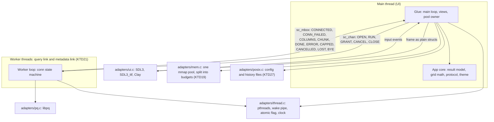
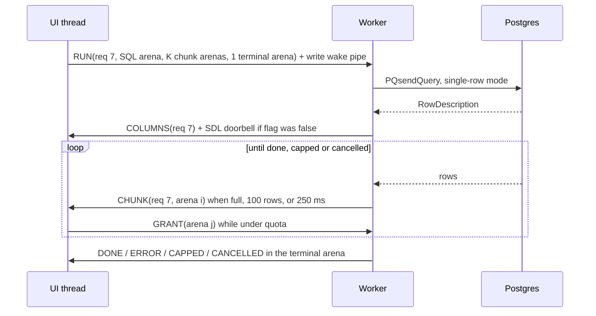
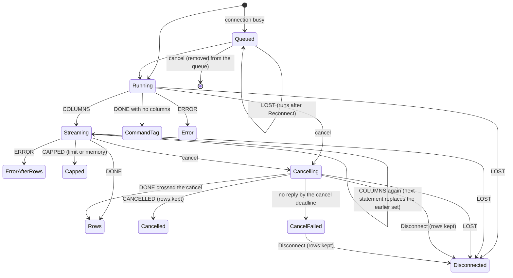
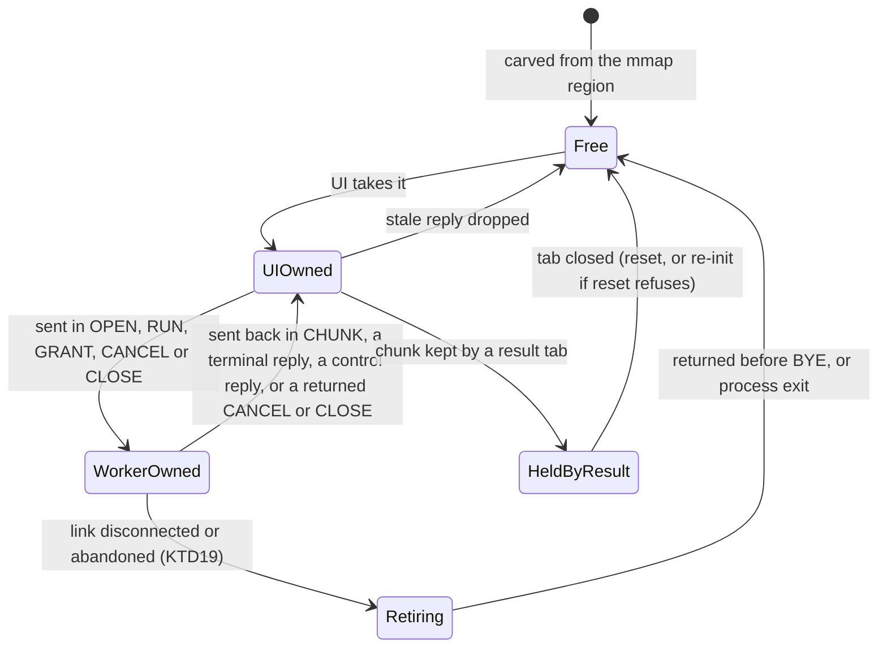
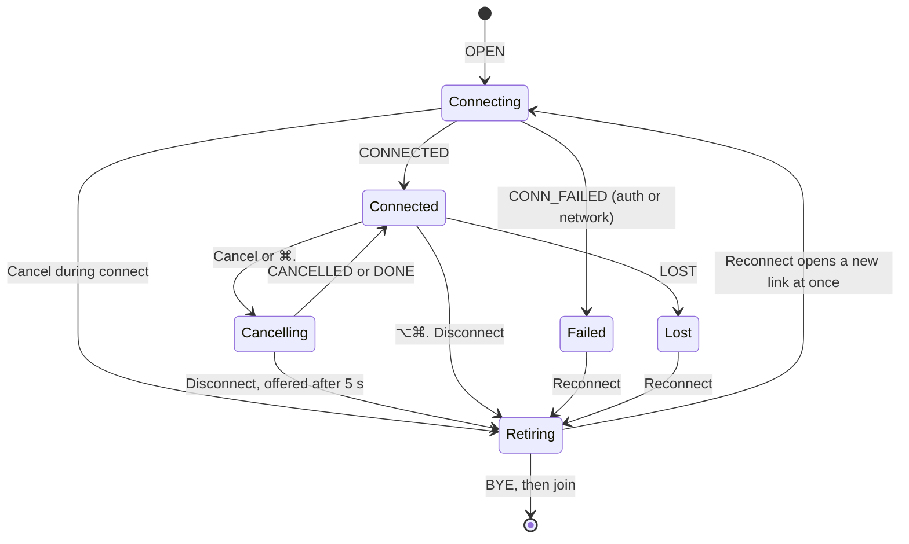
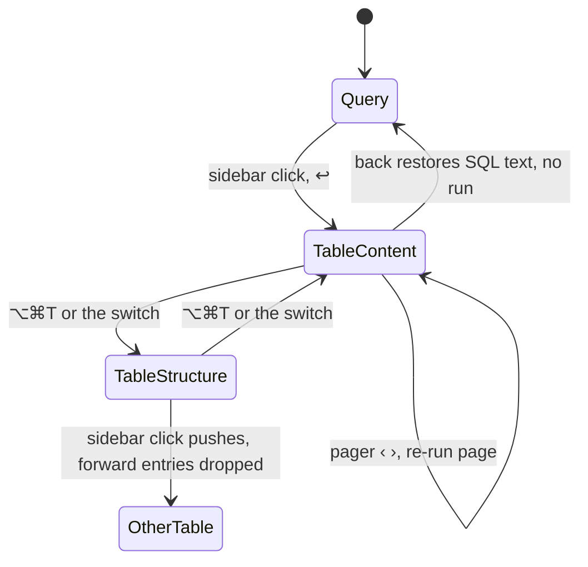
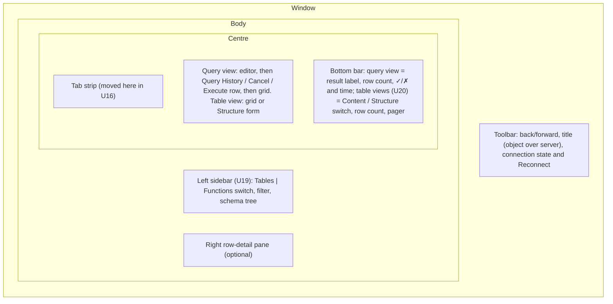

# Postgres Explorer - Plan

## Goal Capsule

- **Objective:** Robert has a Postgres client on his M3 Mac that looks like Postico 2 and that he uses every day once milestone 6 is done. Safe C has a written record of every place the subset, the stdlib or the tooling had to change, or was worked around, to build it.
- **Means:** a new app in `examples/explorer/`, written as subset application code. libpq, SDL3/SDL3_ttf/Clay, pthreads and mmap each sit behind their own adapter (KTD1, KTD2). Generic gaps are fixed in `stdlib/` in the same tree (KTD10).
- **Product authority:** Robert. He owns the subset rules, waivers, and the final visual check on macOS.
- **Execution profile:** one SC-NN stack PR per unit, following `.claude/skills/safe-c-stack-pr/SKILL.md` (KTD16). For each unit an agent builds, runs `make check` plus the checks `AGENTS.md` names for the change, runs `safe-c-review`, fixes every finding, opens the PR and squash-merges it without waiting for Robert. Robert runs the Mac checks the Definition of Done lists, and the milestone summaries list the ones still owed. Units U1 to U25 (milestones 1 to 6) are implemented on `main`. Milestone 6 Mac acceptance remains outstanding.
- **Standing go-ahead:** under Robert's standing decision, an agent may add R0 rows, change a lint rule, add a waiver, change `stdlib/chan.c` or `stdlib/mailbox.c` semantics, or add a dependency. Each such change gets a `BREAKAGE.md` row and a line in the PR body.
- **Stop conditions:** stop and ask Robert before you:
  - change a rule in `docs/subset-v1.md` other than an R0 row;
  - weaken an existing check.

  Also stop if the thread protocol (KTD5) turns out to need a primitive that only a subset change could express.

---

## Product Contract

### Summary

Build a Postgres explorer in Safe C under `examples/explorer/`, in six milestones that are each usable on their own: a window that draws text, connect and run a query, a result grid that scrolls a million rows, cancel and a schema browser, a SQL editor, and daily-use polish. It copies Postico 2's layout and palette. Next to it sits a breakage log of every Safe C rule fight, missing module or slow path, with what fixed it.

### Problem Frame

Safe C has been tested on small programs. The HTTP demo in `examples/http/` is a few hundred lines with one adapter, and the SC-18 trial only linted someone else's code. Neither shows whether the subset holds up in a program with threads, a GUI, unbounded data and a text editor. The fastest way to find out is to build one that Robert depends on, because a tool used daily surfaces the slow paths and missing pieces that a demo never reaches. Building it in this repo means a gap and its fix land together.

### Requirements

**The app**

- R1. The app builds and runs on macOS on Apple Silicon. The same sources build on Linux, where the app runs headless for tests and screenshots.
- R2. The app connects to a Postgres server from a libpq conninfo string, the `PG*` environment variables, and `~/.pgpass`. Saved connections arrive in milestone 6.
- R3. The app runs SQL and streams the result while the window stays responsive. It renders each outcome distinctly: running, rows, empty result, command tag (`UPDATE 3`), error, error after some rows, cancelled, row limit reached, memory limit reached, and disconnected.
- R4. The result grid scrolls a result of one million rows smoothly on Robert's M3. A row limit is on by default, and the user can lift it.
- R5. The user can cancel a running query from a Cancel button or ⌘., and can disconnect when a cancel does not finish (milestone 4).
- R15. After a lost, failed or abandoned connection, the user reconnects without relaunching, and the rows already on screen stay (milestone 4).
- R6. A sidebar browses schemas, tables, views and functions. A table opens in a paged Content view and a read-only Structure view, with back and forward (milestone 4).
- R7. A SQL editor with selection, undo, highlighting and current-statement shading replaces the plain input box, and runs the current statement, the selection or the whole buffer (milestone 5).
- R8. Saved connections, query history, Postico's keyboard shortcuts, copy of the selected rows as tab-separated text and as CSV, and preferences for lines per row and rows per page (milestone 6).
- R16. A password is never written to disk, query history, undo history, the clipboard or the screen (milestone 6).

**The look**

- R9. The window looks like Postico 2:
  - a left sidebar, a centre view and an optional right detail pane;
  - a grid with faint column lines, alternating rows and a solid blue full-row selection;
  - a bottom bar per view;
  - the Postico light and dark palettes, following the system theme;
  - crisp text on a Retina display.

**Safe C**

- R10. Every file under `examples/explorer/` passes `make lint` under the current subset. A subset change happens only after a breakage log entry and Robert's approval.
- R11. Every call into a C library outside the subset lives in an adapter under `adapters/` with a row in the R0 table of `docs/subset-v1.md`.
- R12. A gap that any app would hit is fixed in this tree. A pure-computation gap becomes a proved stdlib module (contract, blind properties, unit tests, fuzz harness, mutation check). A gap that needs libc becomes an adapter with tests and a fuzz harness.
- R13. Every rule fight, missing module, slow path and workaround gets one entry in the breakage log, with its cost and its resolution.
- R14. `make check` passes after every PR, and no existing check is weakened to make room for the app.

### Key Decisions

- **Postgres through libpq is the only engine.** (session-settled: user-directed — chosen over dbdelve's ten engines: Postgres is Robert's daily database.) Governs R2.
- **The app lives in this repo, under `examples/`.** (session-settled: user-directed — chosen over a separate repo: a Safe C gap and its fix land in the same tree.) Governs R10, R12.
- **The breakage log is the main output besides the app.** (session-settled: user-directed — chosen over treating the app alone as the deliverable: the point is to measure Safe C.) Governs R13.
- **macOS on Apple Silicon is the target Robert runs, and Linux is a build and test target.** (session-settled: user-directed — chosen over macOS-only or both as first-class platforms: Robert uses an M3, and the agents work in Linux orbs.) Governs R1.
- **The look follows Postico 2, as a visual target rather than pixel for pixel.** Robert asked for it when confirming scope. Governs R9.
- **Milestones 4 to 6 were planned after the milestone 3 retrospective.** (session-settled: user-approved — chosen over planning all six in full up front: the milestone 3 breakage log changed what milestones 4 to 6 need.) Governs R5–R8, R15, R16.
- **A sidebar click opens the object in the current tab, with back and forward; a ⌘-click opens a new tab.** (session-settled: user-approved — chosen over always opening a new tab: Postico navigates in place, and nine tabs fill fast.) Governs R6.
- **Rows already on screen survive a reconnect.** (session-settled: user-approved — chosen over freeing every tab's rows when the connection is rebuilt: a dropped Wi-Fi link should not erase the results being read.) Governs R15.
- **The pager's N comes from the planner's estimate, then a timed `count(*)`, and the pager shows only "Page k" when the count times out.** (session-settled: user-approved — chosen over always counting or never showing N: an exact count of a large table can take minutes.) Governs R6.
- **A run of several statements shows the last result set, with the earlier command tags listed.** (session-settled: user-approved — chosen over Postico's first set with a "Result N" picker: KTD12 already does this, and `BEGIN; …; SELECT …` reads naturally.) Governs R3, R7.
- **Saved connections are a hand-edited file with a picker in the app.** (session-settled: user-approved — chosen over an in-app editing form: Robert edits text files happily, and a form is a large piece of UI for a rare task.) Governs R8.
- **With no `~/.pgpass` entry, the app asks for the password in a masked prompt and keeps it in memory only.** (session-settled: user-approved — chosen over only a message telling the user to edit `~/.pgpass`.) Governs R16.

Product Contract changes in the milestone 4–6 re-plan: R5 to R8 are sharpened from the outlines without changing their scope, and R15 (reconnect) and R16 (passwords) are new.

### Success Criteria

- After milestone 6, Robert uses the app instead of his current client. Earlier milestones end with a check on his Mac, not with daily use.
- After milestone 3, the app connects to Robert's own database on his Mac, runs read-only queries, and shows results in the grid and the row-detail pane.
- With the row limit lifted, a one-million-row result scrolls on the M3 with frame times recorded in the breakage log. Target: under 16 ms for a full-window grid.
- At the end of each milestone, the breakage log has an entry for every workaround in that milestone's diffs. A reader can say from the log alone which Safe C gaps the milestone found and how each was resolved.

### Scope Boundaries

- Other engines (MySQL, SQLite and so on), and Postgres-compatible forks as first-class targets.
- Windows, Intel Macs, and packaging or signing the app for other people.
- Editing table data, the structure editor's write path, and DDL diffs. Milestone 4 shows structure read-only.
- SSH tunnels, iCloud sync, server groups, pgFormatter, and autocomplete.
- Pixel-exact Postico. Native AppKit controls and the macOS 26 glass toolbar are out; the flat pre-Tahoe look is the target.
- Considered and not built: a shared locked free list for result arenas. KTD5's credit grants use only chan and mailbox, and one allocator thread makes every pool-full decision. Revisit if grants cost measurable latency.
- Considered and not built: golden-image pixel comparison tests. Rendering differs between Metal and the Linux software renderer, and between FreeType versions. Headless screenshots are inspected instead (KTD15). Revisit if visual regressions slip through.
- Considered and not built: automatic re-run of a query after a reconnect. An `UPDATE` is not idempotent. The same rule covers back and forward: returning to a query view restores its SQL, not its result.
- Considered and not built: the DDL view. Postgres has no server function that prints a table's `CREATE TABLE`, and rebuilding one by hand is a large job outside R6. Revisit if Robert asks for it.
- Considered and not built: Postico's Queries box of saved `.sql` files. R8 asks for history, not saved query files, so U19 removes the placeholder box rather than leaving it empty.
- Considered and not built: sorting by a column header and Postico's filter bar in the Content view. Neither is in R6. Content pages order by the key.
- Considered and not built: exporting a result to a CSV file. R8 asks for copy as CSV, which the clipboard covers, and SDL's save dialog cannot run headless.
- Considered and not built: keyset paging. OFFSET matches Postico's "Page k of N" jumps. Revisit if late pages of a large table are slow on Robert's databases.
- Considered and not built: non-contiguous row selection, multiple windows, and font-size shortcuts. Sidebar and editor/result dividers resize for the session only (`panes.c`); sizes are not persisted.
- Considered and not built: italic NULL and emoji or CJK glyphs (milestone 3 rows, still open). They are cosmetic for daily use and need about 10 MB of fonts. Revisit if Robert's data needs them.
- Considered and not built: the open stdlib gaps no milestone 4–6 feature needs (`sc_arena_view`, u64 encode and decode, a seekable reader, arena renewal past `UINT_MAX` epochs). They stay open in `BREAKAGE.md`.

### Outstanding Questions

- Deferred to implementation: SC card numbers continue from SC-44. Confirm in the Notion Tasks DB when each card is created.
- Deferred to implementation: the KTD19 budget sizes, the KTD25 editor sizes and the 1,000-row page size are starting constants. Tune them from measurements and record the final numbers in `BREAKAGE.md`.

---

## Planning Contract

### Key Technical Decisions

- KTD1. **SDL3 and SDL3_ttf draw, Clay lays out, and all three sit behind one UI adapter.** (session-settled: user-directed — chosen over a retained-mode toolkit: immediate mode keeps the most app code inside the subset.) Pin SDL 3.4.18 and SDL3_ttf 3.2.2. All SDL and TTF calls stay on the main thread, which is the UI thread. macOS requires this for SDL, and SDL_ttf requires it for fonts.
- KTD2. **Clay's macros stay inside the UI adapter, and the app sends plain structs.** (session-settled: user-approved — chosen over moving Clay into app code and changing the subset: the subset stays as it is until the breakage log shows the adapter is too thick.) Vendor `clay.h` at a pinned commit under `adapters/third_party/`, because lint scans every `.c` and `.h` under `examples/` (`scripts/lint.py`, `APP_SKIP_DIRS`). Pin a `main` commit at or after `e6cc369`, not tag v0.14: the scroll-offset fix `e4aa952` is newer than v0.14, and `main` has changed the API. The app describes a frame as a `sc_tslice` of node records with parent indices (subset rule R10-no-recursion bans recursion; R1-no-subscript and R6-no-raw-array ban arrays). The adapter walks the records and calls Clay's exported `Clay__OpenElementWithId`, `Clay__ConfigureOpenElement`, `Clay__OpenTextElement` and `Clay__CloseElement`.
- KTD3. **Clay lays out the chrome. The app computes the grid body as a flat draw list.** A full-window grid is about 3,600 cells, and the Clay SDL3 renderer creates a `TTF_Text` per text command per frame. Grid math (visible rows, column offsets, cell rectangles, clipping) is integer subset code the app owns and unit-tests. The adapter draws the list into one Clay custom element and caches shaped text per visible cell.
- KTD4. **The app is split into a pure core and thin glue.** `make test` compiles with only `-Iinclude` and links only `stdlib/*.c` (`scripts/sanitize.py`). So core files include only `safec/*.h` and core headers, and `tests/explorer_*_test.c` include them directly, the way `tests/http_parse_test.c` includes `examples/http/parse.c`. Glue files (`main.c`, `view_*.c`, `worker.c`) include adapter headers. Screenshots and the libpq integration test cover them. Adapter headers include only `safec/*.h` and stay subset-clean, like `adapters/sc_microhttpd.h`. The one exception is `adapters/sc_ui_frame.h`: it declares the frame vocabulary as types only, with no functions, so the core frame builder and its tests can include it by relative path and still link against `stdlib/*.c` alone.
- KTD5. **The UI thread is the only allocator of result arenas, and it grants arenas to workers as credits.** Every message in either direction is the index of a pool arena. The sender writes a header at offset 0 that names the connection, the request id and the kind. Ownership of an arena moves with the message, so no arena is ever read by two threads, which matters because `stdlib/slice.c` reads `epoch` and `used` without atomics.
  - **Credits:** a RUN carries the SQL and grants K chunk arenas plus one reserved arena for the terminal reply, so a terminal reply never waits for credit. Each CHUNK the UI keeps earns the worker one more GRANT, until the result reaches its quota.
  - **Control arenas:** each open connection holds two reserved arenas for its lifetime, counted in the pool size.
    - The worker's arena arrives with OPEN. It carries CONNECTED or CONN_FAILED, and later LOST or BYE, so an idle worker can always report a dropped connection. The UI hands it back after reading each reply.
    - The UI's arena carries CANCEL and CLOSE, so both work even when results hold every other arena. The worker always sends it back, and a CANCEL for a request that already finished comes back under a dead request id and is dropped as stale.
  - **Pool runs dry under quota:** when a CHUNK arrives under quota but the pool has no free arena to grant, the UI sends CANCEL with reason "memory", and the result ends as CAPPED (memory limit), not stuck in Streaming.
  - **Stale replies:** the UI drops any reply whose request id is no longer live and returns its arena to the pool.
  - **Mailbox size:** the mailbox capacity is at least the pool size plus the control messages in flight, so `SC_MBOX_FULL` cannot happen and counts as a bug.
  - **Handles:** each thread keeps its handle table in its own small arena. When every slot has retired at `SC_HANDLE_GEN_MAX`, the thread resets that arena and builds a new table. The ring arenas behind chan and mailbox are separate and are never reset.
  - **Arena structs:** the pool's `sc_arena` structs live in the memory adapter, which hands out `sc_arena *` by index. App code cannot take a pointer into a `sc_tslice` element (logged as a gap).
- KTD6. **Wake-ups: workers poll a self-pipe with the libpq socket, and the UI gets an SDL event plus a timeout.** A worker waits on one `poll()` call over its `PQsocket`, its wake pipe and a timer, because a condition variable cannot wait on a socket. The UI writes the pipe after every `sc_chan_send`. A worker rings the UI with `SDL_PushEvent` only when it flips an atomic pending flag from false to true. The UI clears the flag before draining the mailbox to EMPTY. While any request is active, the UI also waits with `SDL_WaitEventTimeout` at about 100 ms. That covers a failed push and a mailbox EMPTY that hides a send still being published, and it ticks the elapsed-time label.
- KTD7. **The worker makes every libpq call, cancel included.** It connects with `PQconnectStartParams` and `PQconnectPoll`, so closing a connection mid-connect is `PQfinish`. Blocking DNS makes cancel during connect logical only: the UI retires the link at once (KTD19), and the worker discards the late result. After a cancel the worker drains `PQgetResult` to NULL and replies CANCELLED with the rows it kept. Rows use `PQsetSingleRowMode` on every libpq version: libpq 18's chunked rows mode hands a chunk over only once it is full, so rows before a stall miss the 250 ms flush, and it drops the chunk still filling when an error ends the statement (the SC-46 chunked-mode row in `examples/explorer/BREAKAGE.md`). The encrypted, non-blocking cancel API is used when the headers define `LIBPQ_HAS_ASYNC_CANCEL` (libpq 17+; Homebrew ships 18.6). Otherwise the worker falls back to `PQgetCancel`/`PQcancel` (the orb has 15.5; Ubuntu 24.04 has 16.15). The UI cannot tell the two cancel paths apart: on the non-blocking one the worker holds the next query until the cancel has gone through or failed, so a late cancel cannot land on it.
  - **libpq 17 and later (Robert's Mac):** cancel is `PQcancelCreate`, `PQcancelStart` and `PQcancelPoll` inside the worker's poll loop. The worker re-reads `PQcancelSocket` on each poll and keeps its own 10 s deadline, because `connect_timeout` does not apply there.
  - **libpq 15 and 16:** cancel is the blocking `PQcancel`, with keepalive settings so a dead network cannot hold it for ever. After 5 s in Cancelling, the UI offers Disconnect (U13). (session-settled: user-approved — chosen over a separate cancel thread, or `pg_cancel_backend` over the metadata connection, on every version: only the orb's and Linux's libpq block, and Disconnect gives a way out.)
- KTD8. **App code uses integer point coordinates.** SDL's float coordinates would make subset rule R11-no-implicit-conversion fire on every line of layout code. The adapter converts to float, creates the window with `SDL_WINDOW_HIGH_PIXEL_DENSITY`, opens fonts at point size times display scale, and re-measures on `SDL_EVENT_WINDOW_DISPLAY_SCALE_CHANGED`.
- KTD9. **Bundle Inter for UI text and JetBrains Mono for SQL and cells.** Both are under the OFL. Screenshots then match between Linux and macOS, and Apple's SF licence forbids redistributing SF Pro. Loading SF from `/System/Library/Fonts` on macOS can be an option later.
- KTD10. **Generic gaps go to `stdlib/` when they are pure, and to adapters when they need libc.** (session-settled: user-approved — chosen over keeping gap fixes inside the app: other adopters get the fixes.) Conflict call-out: the scope I confirmed listed thread start, file writing and mmap as proved stdlib modules. They cannot be proved, because libc calls are outside WP and `scripts/prove.py` and `scripts/manifest.py` enrol every `stdlib/*.c` except chan and mailbox. They become adapters with tests and a fuzz harness, following `adapters/posix.c`. The pure modules for milestones 1 to 3 are `buf` (byte builder and number formatting, U5) and `utf8` (U9). Milestones 4 to 6 add no stdlib module: the planned hash map is not needed (KTD22), and the SQL tokenizer is app code (KTD24).
- KTD11. **Results live in fixed 256 KiB chunk arenas carved from one mmap'd pool, and each result has a quota.**
  - **Cells:** a stored cell holds at most 4 KiB, plus its true length, a NULL flag and a truncated flag, so any row of up to about 60 wide columns fits one chunk. Copy and CSV warn when a value is truncated.
  - **Limits:** the default row limit is 10,000, and "Load all" re-runs the query with only the memory quota. When the limit or the quota is reached, the worker stops forwarding, cancels, drains, and replies CAPPED with the reason.
  - **Flushing:** a chunk is sealed when it is full, at 100 rows for the first chunk, or 250 ms after its first row. The first rows then appear quickly.
  - **Index:** the quota bounds how many chunks a result can have, so the chunk index is a fixed-capacity `sc_tslice` and milestone 3 needs no growable vector (logged).

  All the numbers are starting constants to tune with U12's measurements. The pool is shared by every connection and split into budgets by KTD19.
- KTD12. **SQL goes through the simple query protocol.** For multi-statement text, the app shows the last result set and lists the earlier command tags in the footer, so `BEGIN; …; SELECT …` works.
  - The worker only learns a result set was not the last when the next one starts. So a second COLUMNS for the same request replaces the earlier set: the UI returns that set's chunk arenas to the pool and resets the request's credit ledger to its RUN grant. The worker sends the earlier command tags with the terminal reply.
  - When the row limit or quota caps a set that is not the last, the cancel stops the later statements and, inside `BEGIN`, aborts the transaction. The footer then says that later statements did not run, and shows the transaction state from `PQtransactionStatus`.
  - The worker answers `COPY … FROM STDIN` with `PQputCopyEnd` and an error, drains `COPY … TO STDOUT`, and reports both as unsupported, so the connection never hangs.
- KTD13. **The breakage log is `examples/explorer/BREAKAGE.md`, and a research-wiki concept page summarises it.** (session-settled: user-approved — chosen over a page inside `research-wiki/` or the `docs/evidence/` precedent from SC-18: the log stays next to the code it describes.) Each entry is one row:
  - date and milestone;
  - the rule, module or tool;
  - what happened, and what it cost;
  - the resolution: stdlib fix, adapter, app workaround, or proposed subset change;
  - the PR.
- KTD14. **SDL3 is built on Linux from a pinned-source install script, and an `.agents/setup` script prepares every orb.** Ubuntu 24.04 (the CI image) has no SDL3 package. The orb is Debian 12 (bookworm), which lacks clang 18, cmake and a Postgres server, so `.agents/setup` installs clang-18, clang-tidy-18 and the compiler-rt and libFuzzer packages from apt.llvm.org, cmake and PostgreSQL 15 from Debian, and semgrep 1.181.0 through pip. It then runs the SDL install script. Each stacked unit may start in a fresh orb, so without this script every PR would redo the setup by hand before `make check` could run.
- KTD17. **The UI adapter owns the C `main`.** `int main(int argc, char **argv)` and any `argv[i]` read fail subset rules R3-no-char-ptr and R1-no-subscript, which is why `examples/http/server.c` declares `main(void)`. `adapters/ui.c` defines `main`, turns the arguments into a `sc_tslice` of `sc_str` in an adapter-owned arena, and calls `app_main`, which `sc_ui.h` declares and `examples/explorer/main.c` defines. This is logged as a gap: there is no subset-clean way to receive argv.
- KTD15. **Visual checks use headless screenshots on Linux, and Robert checks the Mac.** The binary takes `--scene <name> --screenshot <png>`. It renders a fixed scene with `SDL_VIDEO_DRIVER=offscreen` and the software renderer, reads the pixels before present, and saves them with `SDL_SavePNG`. Agents inspect each affected scene against the Postico palette.
- KTD16. **Each unit is one SC card and one stacked PR.** Units that add a proved module follow the blind-property order in `safe-c-stack-pr`: commit declarations with no contract, run `scripts/blind.py author`, then write the contract and code.

- KTD18. **Hit testing uses the rectangles the adapter laid out, reported back per tagged node.** A node record may carry a nonzero 32-bit tag, unique within its frame. After layout, `ui_draw` writes each tagged node's rectangle, in integer points, into an `sc_tslice` the app supplies. The next input event is hit-tested against those rectangles. This is the standard immediate-mode one-frame lag, invisible because a frame is redrawn after every event. It replaces the hand-kept grid origin and the tab strip's band arithmetic, and it closes the milestone 3 "hit origin" row. Considered and rejected: copying the shared-span pattern of `tab_span_at` for each of the ten or so new kinds of control. Every copy can drift from Clay's layout, and nothing would notice.
- KTD19. **One result pool is shared by every connection and split into budgets, with a reserved floor.** `main.c` owns the pool, and each link draws from its budget.
  - **Starting split:** 192 arenas (48 MiB).
    - Link slots are fixed: the query link, the metadata link and up to two retiring links. Each slot's two KTD5 control arenas come from an 8-arena control reserve.
    - The metadata link has 16 arenas of its own.
    - A floor of 30 ((9 tabs + 1 live run) × (RUN + COLUMNS + first chunk)) serves only a run's first arenas. A RUN that has to start from the floor grants one chunk arena instead of KTD5's window of K.
    - The other 138 are growth for the query link, still capped at 128 per result (KTD11).
  - **What it guarantees:** any run can always start and finish a one-chunk result, and two Load-all results cannot block the sidebar or `SELECT 1`.
  - **Retiring a link:** the UI stops reading a link it disconnects or abandons mid-connect, and moves it to a retiring slot. A retiring link is polled until BYE and then joined. `budget.c` charges the arenas it still holds to a retiring owner, taken from growth, never from the floor or the new metadata link's 16. They return to the pool as they come back, or at process exit. While both retiring slots are busy, Reconnect stays disabled and reads "Waiting for the old connection". A rebuilt link never touches arenas a tab holds.

  This supersedes the per-connection pool kept in U12, as the U7 breakage row first planned.
- KTD20. **Orbs build libpq 18 from pinned source, so the Mac's code paths are compiled and tested before they reach the Mac.** `scripts/install-libpq.sh` builds only libpq from the Postgres 18 release tarball, pinned by version and SHA-256, into `build/tools/libpq18`, as `install-sdl3.sh` does for SDL. `pq-test` then runs once against the system libpq 15 and once against libpq 18, against the same Postgres 15 server, so the non-blocking cancel runs in CI. U13 compiled both. Considered and rejected: the PGDG apt packages, which replace the system libpq that the rest of the orb uses.
- KTD21. **Catalog reads go over a second, metadata connection, one statement per RUN.**
  - **Connecting:** the metadata link opens after the query link connects, with the same connection settings plus `application_name=explorer-meta` and a 10 s `statement_timeout`, so a lock never hangs the sidebar. Reconnect rebuilds both links.
  - **One statement per RUN:** KTD12's later-set-replaces-earlier rule would otherwise drop all but the last result.
  - **Queries:** the queries follow `psql -E`, schema-qualified with `pg_catalog.`. They filter by oid literals, never by spliced names, so the simple protocol needs no string escaping.
  - **Quoting:** identifiers in generated SQL are always double-quoted, with `"` doubled.
- KTD22. **No hash map module.** The sidebar addresses records by row index. Type names come from the server's `format_type`. Keywords use a sorted table and binary search (U14). A by-oid lookup, needed only when back returns to a table, scans one schema's records. The `map` module the outline expected gets a breakage row: planned, not needed.
- KTD23. **Each tab keeps a view stack of up to 16 entries.** An entry is a query view, holding its SQL text, or a table view, holding its oid, name, Content or Structure, and page. Opening an object pushes an entry and drops the forward entries. ‹ › and ⌥⌘←/→ move through the stack. Leaving a view frees its result. Returning to a table runs its page again, and returning to a query restores only its SQL text. This is the how of the product decision that a sidebar click navigates the current tab. (session-settled: user-approved — chosen over opening each object in a new tab: Postico navigates in place.) Governs R6.
- KTD24. **The SQL tokenizer is proved in the app tree, and the scripts are extended so that mutation runs on it.** (session-settled: user-approved — chosen over moving a SQL lexer into `stdlib/`, where every gate already applies: a SQL lexer is not a gap other adopters hit, and KTD10 keeps the stdlib generic.)
  - **Proof:** `make prove PROVE_SRC=examples/explorer/sqltok.c` already works.
  - **Mutation:** `scripts/mutate.py` copies the source file's own directory into its temporary tree, so `sqltok.h` is there for the baseline.
  - **CI:** a new `explorer-prove` step in `scripts/ci.py` runs both, since the default `make prove` and `make gates` cover `stdlib/*.c` only.
  - **No blind properties:** `scripts/blind.py` and `make properties` stay limited to stdlib modules. That gap is logged in `BREAKAGE.md`. It is not a weakened check, because no existing check covered app code.
- KTD25. **The editor is a gap buffer with a bounded undo ring and a resumable lexer.**
  - **Buffer:** each tab's gap buffer holds up to 1 MiB in an arena from the tab pools, replacing `input.c`'s flat 64 KiB buffer and its O(n) inserts.
  - **Undo:** undo keeps up to 100 steps in a ring and drops the oldest when full. Each record holds its byte offsets and the bytes it removed and inserted. The ring is 2.25 MiB, so one step that replaces a full 1 MiB buffer with a 1 MiB paste always fits. A typing run is one step while it stays contiguous, has the same kind (insert or delete) and continues within 500 ms (CodeMirror's defaults). A cursor move, selection change, paste, cut, composition commit or run ends the step. A new edit clears redo.
  - **Highlighting:** the lexer never sees the gap buffer. The lexer state is saved every 4 KiB. An edit copies text from the checkpoint before it, 4 KiB at a time, into a scratch arena, and re-lexes until the state at a later checkpoint matches again. Checkpoints after the edit shift by the edit's length. A dollar tag travels in the state as its own copy of the tag bytes, kept in the checkpoint arena, so checkpoints compare by content and survive edits before them.
  - **Colours:** keywords #253BF4 (light) and #54B0F8 (dark); strings #B88E3A and #FFFF88; comments in the secondary-text token; the current-statement band #F2F2F2 and #424242.
- KTD26. **⌘ is the GUI key on macOS and Ctrl elsewhere, and Ctrl stays its own modifier on macOS.** The adapter reports a platform-neutral command modifier plus the real Ctrl, and the core key maps take the platform as a parameter so both run in tests. This frees ^⌘←/→ (history) and the Mac's ^A, ^E and ^K line keys, which today's "GUI or Ctrl" mapping swallows.
- KTD27. **Per-user files live in SDL's preference directory, and every write is atomic.** The UI adapter returns `SDL_GetPrefPath("Safe C", "Explorer")` as an `sc_str`. On macOS that is `~/Library/Application Support/Safe C/Explorer/`; on Linux it is the XDG data directory, which tests point at a temporary directory through `XDG_DATA_HOME`. `adapters/posix.c` gains `open` for write (`O_CREAT | O_EXCL`, mode 0600), `write` (retrying EINTR and short writes), `fsync`, `rename` and `unlink`, with errno in `err`. A save first unlinks any leftover temporary file (ENOENT is not an error), then writes a new one, syncs it, and renames it over the target.
- KTD28. **A typed password travels only as its own OPEN field and lives only in one UI arena.** OPEN carries the connection settings and an optional password field. The libpq adapter passes it as the `password` parameter, never inside a string that could be shown or logged. Both links reuse it for reconnects. The arena is zeroed when the session ends. The prompt field draws bullets and has no undo, copy, cut or history. It starts text input as a hidden password (U21), ignores compose events, and never reports its caret area.

### High-Level Technical Design

Components and the only paths between them:



One query, with credit grants and the wake-ups:



Query states the UI renders (R3):



Who owns a pool arena at each step:



One connection's life, with reconnect (U13, KTD19). Reconnect retires the old link and opens a new one, and the tabs' rows stay in the shared pool throughout:



What a tab shows, and how back and forward move (KTD23):



Window layout to match Postico:



### System-Wide Impact

- **Shared repo surfaces:** `AGENTS.md` (module list, adapter paragraphs, check table), `docs/subset-v1.md` (R0 rows only), `ci/Dockerfile` and `scripts/ci.py` (new steps), `waivers.toml`, `CHANGELOG.md`.
- **Installed library:** `buf` and `utf8` join `libsafec.a` and the installed headers, so `make package-test` and adopters see them. Adapters stay outside the installed library, as today.
- **Lint scope:** `make lint` picks up `examples/explorer/` with no registration, so a lint failure in the app fails `make check` for every PR in the repo.
- **Heavier checks:** `make ci` runs the explorer build (`explorer-build`), the libpq integration tests (`explorer-pq`, `explorer-pq18`) and the explorer proof step (`explorer-prove`), which need SDL3, a Postgres server and Frama-C. `ci.py`'s guard only checks that a file exists, so on a machine without those tools those steps fail. `make gates` still skips them.
- **Proof tooling:** `scripts/mutate.py` learns to copy a source file's own directory (KTD24). Every existing `MUTATE_SRC` run copies one more directory and is otherwise unchanged.
- **Adapters:** `adapters/posix.c` gains write calls (KTD27), so its R0 row and its `AGENTS.md` paragraph change. `adapters/ui.c` already has pointer detail, tagged-node rectangles, composition, clipboard write and cursor shape (U16, U21); it still gains the preference directory (U15, KTD27).
- **Robert's files:** the app reads the hand-edited `connections.conf` and `settings.conf` from `~/Library/Application Support/Safe C/Explorer/`, and writes its history file there. History is plaintext SQL, so it is written mode 0600 (KTD27).

### Risks

- **Clay's API is moving.** `main` broke the v0.14 API in 2026. Mitigation: pin a commit (KTD2) and read its log before any bump. The adapter is the only file that changes.
- **Grid speed on the Mac is unmeasured.** Mitigation: KTD3 keeps the grid off Clay, and U12 measures before milestone 3 closes.
- **Linux and macOS take different libpq paths.** The orb exercises the old cancel and the Mac the new one; both use single-row mode (KTD7). The Mac's path had not been compiled before U13. Mitigation: KTD20 runs `pq-test` against libpq 18 in the orb from U13 on, and `pq-test` on the Mac stays on the milestone check list.
- **A blocking cancel can hold the worker on libpq 15.** An unreachable server keeps `PQcancel` waiting for a TCP timeout. Mitigation: Disconnect after 5 s retires the link, and the UI never waits on it (KTD7, KTD19).
- **Proving a lexer may cost far more prover time than `utf8` did.** Mitigation: keep the proved file to the byte walk and the depth counters, and leave keyword lookup outside it (U14). If WP stalls on one construct, log the shape that worked, as U5 and U9 did.
- **Composition, the I-beam and clipboard behaviour cannot be checked headless.** Mitigation: the adapter's scripted scenes cover event translation (U21). Robert's milestone 5 check covers a real IME and dead keys.
- **A long session holds a large plaintext history.** Mitigation: mode 0600, and the 500-entry and 1 MiB bounds (U24).
- **Visual checks on the Mac depend on Robert.** Mitigation: headless screenshots catch layout and palette mistakes first. Each milestone ends with an explicit Mac check.

### Assumptions

- Postico truncates very large cells in its grid. This was not checked against Postico. KTD11's 4 KiB cap is chosen on its own merits.
- Clay's layout cost for the chrome (a few hundred elements) is negligible. U3 checks this when it builds the shell.
- Postico's default page size is 1,000 rows. It is commonly cited but not documented. U25 makes it a preference.
- Postico's colours for numbers and comments are not visible in its screenshots. KTD25 draws numbers in the text colour and comments in the secondary-text colour.
- ⌥⌘C for Copy as CSV is this plan's choice. Postico puts CSV under a Copy Special menu, and the explorer has no menus.
- SDL's offscreen video driver keeps an internal clipboard, so U21's scripted clipboard scene runs headless. If it does not, that scene moves to the Mac check list.
- Materialised views have `ctid`, as heap relations. U20's integration fixture confirms it.

### Sources

- `examples/http/` and `adapters/microhttpd.c`: the template. The fixed arena pool with re-init on epoch wrap is the pattern KTD5 extends.
- `include/safec/chan.h`, `include/safec/mailbox.h`, `include/safec/handle.h`: one handle plus one `size_t` per message, no call blocks, and handle slots retire at generation 65535.
- `scripts/lint.py` (`APP_SKIP_DIRS`, `application_sources`, `parse_clang_rules`) and `scripts/tools.py` (`CLANG_FLAGS`): what lint scans and the flags behind KTD2, KTD4 and KTD8.
- `docs/evidence/sc18/mo-base-lint.md`: the SC-18 gap table (no append, no number formatting, fixed-capacity arenas), the precedent for the breakage log.
- Postico 2 site, documentation and screenshots (https://eggerapps.at/postico2/, https://eggerapps.at/postico2/documentation/keyboard-shortcuts.html, https://eggerapps.at/postico2/documentation/sql-query-view.html): layout, palette and shortcuts. The measured palette is in U3.
- SDL 3.4.18 docs `README-highdpi.md` and `README-main-functions.md`, plus header thread-safety tags: main-thread rules and `SDL_PushEvent` from any thread.
- Clay README and `renderers/SDL3/clay_renderer_SDL3.c`: element limits, string lifetime (strings are never copied), and the per-frame `TTF_Text` cost behind KTD3.
- libpq docs §32.6 (chunked and single-row mode), §32.7 (cancel) and §32.20 (threading): KTD7.
- libpq 15 source `fe-connect.c` (`PQcancel` blocks in `connect`, `send` and `recv`, and ignores `connect_timeout`) and https://www.postgresql.org/docs/current/libpq-cancel.html (`PQcancelCreate`, `PQcancelPoll`, `PQcancelSocket`): KTD7.
- `psql -E` output for `\dn`, `\dt+`, `\d` and `\df` from psql 15.19, and the catalog pages for `pg_class` (`reltuples` is −1 before ANALYZE since PG 14), `pg_attribute` and `pg_constraint` (PG 18 stores NOT NULL as `contype = 'n'`): KTD21, U18.
- Postgres lexical rules (https://www.postgresql.org/docs/current/sql-syntax-lexical.html) and psql's `psqlscan.l` (nested comments, `BEGIN ATOMIC` depth): U14.
- Postico GitHub issue #16 (paging by primary key or `ctid`) and Postico's table screenshots (bottom bar, pager, Structure chips, syntax colours): U19, U20, KTD25.
- SDL 3.4 headers `SDL_events.h` (`SDL_TextEditingEvent`, `clicks`), `SDL_keyboard.h` (`SDL_SetTextInputArea`), `SDL_clipboard.h`, `SDL_mouse.h` and `SDL_filesystem.h` (`SDL_GetPrefPath`, thread-safe; the others main-thread only): U21, KTD27.
- CodeMirror 6 `history()` defaults (100 steps, 500 ms grouping): KTD25.

---

## Output Structure

```text
examples/explorer/
  Makefile            build, run, screenshots, pq-test against libpq 15 and 18
  README.md, BREAKAGE.md, fonts/, pgtest.sh
  core (unit-tested):
    frame, theme, proto, conn, wire, result, grid, detail, tabs, query_text   (milestones 1-3)
    focus             focused area and global key table (U16)
    budget            pool budgets and the floor (U17)
    catalog           catalog reads, records, identifier quoting (U18)
    tree              sidebar rows from expansion state (U19)
    nav, page         per-tab view stack; Content page SQL and pager (U20)
    sqltok (proved), sqlkw   lexer and splitter; keyword set (U14)
    editor            gap buffer, selection, undo (U22; replaces input)
    copy              TSV and CSV from a row range (U15)
    conncfg, prefs    connections.conf and settings.conf parsers (U23, U25)
    history           query history ring and file format (U24)
  glue:
    main.c, link.c, worker.c, view_shell.c, view_grid.c
    view_sidebar.c, view_table.c, view_editor.c, view_picker.c, view_history.c   (new)
adapters/
  ui.c, sc_ui.h, sc_ui_frame.h   SDL3, SDL3_ttf, Clay, C main; tags, composition, clipboard, prefs dir
  third_party/clay.h, third_party/CLAY_VERSION
  pq.c, sc_pq.h       libpq, both cancel paths, password parameter
  thread.c, mem.c, posix.c (gains write calls in U24)
include/safec/buf.h, utf8.h; stdlib/buf.c, utf8.c
scripts/install-sdl3.sh, scripts/install-libpq.sh (U13), scripts/mutate.py (U14), .agents/setup
tests/explorer_*_test.c, tests/explorer_pq_integration.c, tests/bench/explorer_result_bench.c
fuzz/explorer_*_fuzz.c
```

---

## Implementation Units

| U-ID | Title | Key files | Depends on |
| --- | --- | --- | --- |
| U1 | Toolchain, scaffold and breakage log | `scripts/install-sdl3.sh`, `.agents/setup`, `examples/explorer/Makefile`, `BREAKAGE.md`, `ci/Dockerfile` | none |
| U2 | UI adapter: window, fonts, Clay from plain structs | `adapters/ui.c`, `adapters/sc_ui.h`, `adapters/third_party/clay.h` | U1 |
| U3 | Postico shell, theme and headless scenes | `theme.c`, `view_shell.c`, `main.c` | U2 |
| U4 | Thread and memory adapters | `adapters/thread.c`, `adapters/mem.c` | U1 |
| U5 | `buf` stdlib module | `include/safec/buf.h`, `stdlib/buf.c` | U1 |
| U6 | Protocol and connection state machine | `proto.c`, `conn.c` | U4, U5 |
| U7 | libpq adapter, worker loop, integration test | `adapters/pq.c`, `worker.c`, `pgtest.sh` | U4, U6 |
| U8 | Connect, run and show one result | `main.c`, `input.c`, `view_grid.c` | U3, U7 |
| U9 | `utf8` stdlib module | `include/safec/utf8.h`, `stdlib/utf8.c` | U1 |
| U10 | Result model | `result.c` | U6, U9 |
| U11 | Virtualised grid in Postico style | `grid.c`, `view_grid.c` | U8, U10 |
| U12 | Tabs, close and quit mid-stream, million-row measurement | `main.c`, `conn.c`, `BREAKAGE.md` | U11 |
| U16 | Layout feedback, pointer detail and the focus model | `adapters/ui.c`, `sc_ui_frame.h`, `focus.c`, `main.c` | U12 |
| U17 | One result pool with budgets and a reserved floor | `budget.c`, `link.c`, `worker.c`, `main.c` | U12 |
| U13 | Cancel, disconnect and reconnect | `adapters/pq.c`, `worker.c`, `conn.c`, `link.c`, `scripts/install-libpq.sh` | U16, U17 |
| U18 | Metadata connection and catalog model | `catalog.c`, `main.c`, `pgtest.sh` | U13, U17 |
| U19 | Sidebar browser | `tree.c`, `view_sidebar.c`, `view_shell.c` | U16, U18 |
| U20 | Table Content and Structure views, with back and forward | `nav.c`, `page.c`, `view_table.c`, `view_grid.c` | U19 |
| U21 | Adapter text surface: composition, clipboard write and cursor shape | `adapters/ui.c`, `adapters/sc_ui.h` | U16 |
| U14 | Proved SQL tokenizer and statement splitter | `sqltok.c`, `sqlkw.c`, `scripts/mutate.py`, `scripts/ci.py` | U1 |
| U22 | SQL editor | `editor.c`, `view_editor.c`, `theme.c` | U14, U18, U21 |
| U15 | Multi-row selection, ⌘C and Copy as CSV | `copy.c`, `grid.c`, `view_grid.c` | U21, U22 |
| U23 | Saved connections, picker and password prompt | `conncfg.c`, `view_picker.c`, `proto.c`, `adapters/pq.c` | U13, U20, U22 |
| U24 | Query history | `adapters/posix.c`, `history.c`, `view_history.c` | U22, U23 |
| U25 | Shortcuts, preferences and the last Postico details | `prefs.c`, `focus.c`, `grid.c`, `view_sidebar.c` | U15, U23, U24 |

Units are listed in build order. U13, U14 and U15 keep the IDs of the milestone outlines they grew from, so they sit out of numeric order.

### Milestone 1: a window that draws text

### U1. Toolchain, scaffold and breakage log

- **Goal:** an orb, the CI image and Robert's Mac can each build an empty `examples/explorer` app, lint it, and add to the breakage log.
- **Requirements:** R1, R10, R13, R14
- **Dependencies:** none
- **Files:**
  - `scripts/install-sdl3.sh`, `.agents/setup` (new)
  - `ci/Dockerfile`
  - `examples/explorer/Makefile`, `examples/explorer/README.md`, `examples/explorer/BREAKAGE.md`, `examples/explorer/main.c` (new)
  - `scripts/ci.py`
  - `AGENTS.md`
  - `research-wiki/concepts/safe-c-application-stress-test.md` (new), `research-wiki/index.md`, `research-wiki/log.md`, `research-wiki/queries/open-questions-for-safe-c.md`
- **Approach:**
  1. `install-sdl3.sh` builds SDL 3.4.18 and SDL3_ttf 3.2.2 (against the system FreeType and HarfBuzz, because the release tarball carries no vendored copies) into `build/tools/sdl3`, pinned by tag and SHA-256, in the style of `scripts/install-tlapm.sh`. The dummy and offscreen video drivers are on by default.
  2. The Makefile mirrors `examples/http/Makefile`. Flags come from `pkg-config sdl3 sdl3-ttf libpq`, with `PKG_CONFIG_PATH` covering `build/tools/sdl3` and Homebrew's keg-only libpq. Output goes to `build/explorer/`.
  3. The Dockerfile adds `libpq-dev`, `postgresql-16`, the SDL build dependencies, and the same pinned SDL build as the install script, inlined because the image's build context is `ci/`.
  4. `ci.py` gains an `explorer-build` step in the tree lane, guarded on the Makefile existing.
  5. `.agents/setup` prepares a fresh Debian 12 orb per KTD14, so `make check`, the app build and `pq-test` run with no manual step.
  6. Seed `BREAKAGE.md` with the gaps research already found: a handle must be allocated to send one `size_t`; handle tables retire with no renewal API; there is no MPMC queue or free list; there is no blocking wait; there is no atomic flag outside chan and mailbox; thread, file and mmap work cannot be proved; Clay cannot live under `examples/`; there is no pointer to a `sc_tslice` element; there is no append or number formatting; there is no subset-clean way to receive argv (KTD17).
  7. Create the wiki concept page following `research-wiki/SCHEMA.md`. It needs two outbound wikilinks, taxonomy tags only (`safe-dialect`, `agent-workflow`), an index and log entry, and a clean wiki lint.
  8. Add an `AGENTS.md` paragraph for `examples/explorer/` and a row in its check table.
- **Patterns to follow:** `examples/http/Makefile`, `scripts/install-tlapm.sh`, the `http-smoke` row in `scripts/ci.py`, `docs/evidence/sc18/mo-base-lint.md` for the gap table shape.
- **Execution note:** mostly packaging. Prove it with a build and `make check`, not unit tests.
- **Test expectation:** none — scaffolding. U2 brings the first behaviour.
- **Verification:** in a fresh orb after `.agents/setup`, `make -C examples/explorer` builds a binary that exits cleanly, `make check` passes with `main.c` linted, and `python3 research-wiki/tools/lint.py` reports 0 issues. On the Mac, the README's Homebrew steps build the same binary.

### U2. UI adapter: window, fonts, Clay from plain structs

- **Goal:** app code opens a Retina-sharp window, describes a frame as plain structs, and receives input events, without including SDL or Clay.
- **Requirements:** R1, R9, R10, R11
- **Dependencies:** U1
- **Files:**
  - `adapters/ui.c`, `adapters/sc_ui.h`, `adapters/sc_ui_frame.h` (new)
  - `adapters/third_party/clay.h`, `adapters/third_party/CLAY_VERSION` (new)
  - `examples/explorer/fonts/` (Inter, JetBrains Mono, OFL texts)
  - `docs/subset-v1.md` (R0 row)
  - `examples/explorer/frame.c`, `frame.h` (new, core frame builder), `examples/explorer/main.c`
  - `tests/explorer_frame_test.c` (new)
- **Approach:**
  1. `sc_ui_frame.h` declares the frame vocabulary in subset types (KTD4), and `frame.c` builds frames into a per-frame arena. A node record holds a parent index, direction, sizing, padding, gap, colour, corner radius, border and an optional text (`sc_str`, font id, size, colour). A draw-list record for custom regions holds a rect, a text or a line. Input events carry key, modifiers, text-input bytes, pointer, wheel and resize.
  2. Coordinates are integer points (KTD8). The adapter owns the float conversion, HiDPI and font scaling.
  3. `ui.c` defines `SDL_MAIN_HANDLED` and the C `main`, which calls the app's `app_main` with its arguments as `sc_str` values (KTD17). It keeps every SDL and TTF call on the main thread (KTD1). It exposes init, poll or wait-with-timeout, a frame begin and end, text measurement, `ui_wake` (the `SDL_PushEvent` doorbell, the only thread-safe call), and a screenshot call (KTD15).
  4. The adapter walks the node records in index order and calls Clay's exported element functions (KTD2). Clay's arena comes from a buffer the adapter allocates. Text bytes stay valid until the frame is drawn, because they live in the app's frame arena, which is reset only after `ui_frame_end`.
  5. Text rendering caches `TTF_Text` objects keyed by bytes, font and size, and evicts the ones not used last frame.
  6. Follow the system theme, and report `SDL_EVENT_SYSTEM_THEME_CHANGED`.
- **Patterns to follow:** `adapters/sc_microhttpd.h` (subset-clean header, caller obligations in comments), the header comment and R0 note in `adapters/microhttpd.c`, the Clay SDL3 renderer for rounded rects with `SDL_RenderGeometry`.
- **Test scenarios:**
  - A frame built with three nested nodes in `frame.c` encodes parent indices that point earlier in the list. A node whose parent index is at or after its own index is rejected.
  - Closing more nodes than were opened is rejected, and a frame ended with nodes still open is rejected.
  - A frame builder that runs out of node capacity reports failure and the frame is dropped, not half-drawn.
  - A text node's bytes still compare equal to the input after a second node is added, because both live in the frame arena (Clay never copies strings).
- **Verification:**
  - A headless run renders a scene with "Hello" in Inter and in JetBrains Mono, and the PNG is inspected.
  - On the Mac at 2x, the text is sharp. This is Robert's check.
  - `make lint` passes `main.c` while it includes `sc_ui.h`.

### U3. Postico shell, theme and headless scenes

- **Goal:** the empty app already reads as Postico's query view: toolbar, the two boxed sidebar panes, a centre placeholder, and the query results bottom bar, in light and dark. The Content / Structure switch belongs to table views and arrives with them in U20.
- **Requirements:** R9
- **Dependencies:** U2
- **Files:**
  - `examples/explorer/theme.c`, `examples/explorer/theme.h` (new, core)
  - `examples/explorer/view_shell.c` (new, glue)
  - `examples/explorer/main.c`, `examples/explorer/Makefile` (a `screenshots` target)
  - `tests/explorer_theme_test.c` (new)
- **Approach:**
  1. `theme` holds the two palettes as integer RGBA tokens with the hex values measured from Postico's screenshots. Light: content #FFFFFF, alternate row #F4F5F5, grid header #F7F7F8, header line #DFDFDF, column line #F5F5F5, row selection #2962D9, accent #3478F6, sidebar border #D9D9D9, sidebar selection #BAD6FC and #DCDCDC unfocused, bottom bar #ECECEC, secondary text #7C7D7C. Dark: #1E1E1E, #2A2A2B, #333333, #595959, #353435, #2457C9, #397CF7, #666666, #466287 and #414141, #2F2F2F, #A1A1A1.
  2. Metrics in points: grid header 19, grid row 23 with one text line, sidebar row 23, bottom bar 30, buttons 20 with a 4 pt radius, 4 pt outer insets, 13 pt UI text, maximum auto column width 300. The one-line 23 pt grid row is a deliberate departure from the two-line 30 pt rows in Postico's screenshots. Postico makes lines per row a preference, and that can come in milestone 6.
  3. `view_shell` builds the chrome as nodes each frame from app state: which views are shown, the window title (object over server), and the connection state.
  4. The query results bottom bar follows Postico's: the result label or earlier command tags on the left, the row count or tag in the centre, and a ✓ or ✗ with the elapsed time on the right.
  5. Until U19 and U20 fill them, back and forward are drawn disabled, and each sidebar box shows a grey caption saying what will appear there.
  6. The `screenshots` target renders the scenes `shell-light` and `shell-dark` into `build/explorer/scenes/`.
- **Test scenarios:**
  - Looking up each token in light and dark returns the documented hex value. A token table wrongly copied between modes fails.
  - Switching themes changes every token that differs between the palettes. (Postico's measured accent differs too, #3478F6 against #397CF7; only text drawn on a selection stays white in both.)
- **Verification:** both scenes show the shell with its sidebar boxes and query results bar. They are inspected against the palette list, and their PNGs go into the PR. Robert checks it on the Mac at the end of milestone 1. Breakage log entries cover any R11-no-implicit-conversion or R3-no-char-ptr fights the view code hit.

### Milestone 2: connect and run one query

### U4. Thread and memory adapters

- **Goal:** app code can start and join a worker, wake it, flag the UI, read a monotonic clock, and get a pool of arenas from mapped memory.
- **Requirements:** R11, R12
- **Dependencies:** U1
- **Files:**
  - `adapters/thread.c`, `adapters/sc_thread.h`, `adapters/mem.c`, `adapters/sc_mem.h` (new)
  - `tests/thread_test.c`, `tests/mem_test.c`, `fuzz/thread_fuzz.c`, `fuzz/mem_fuzz.c` (new)
  - `docs/subset-v1.md` (R0 rows), `AGENTS.md` (adapter paragraph)
- **Approach:**
  1. `sc_thread` provides:
     - thread start with an explicit stack size (macOS defaults secondary threads to 512 KB), and join;
     - an `sc_wake`, a non-blocking self-pipe whose write end is safe to call from any thread;
     - an atomic flag with set-if-clear and clear;
     - a monotonic millisecond clock.

     The pq adapter polls the wake's read end (KTD6).
  2. `sc_mem` maps one region with `mmap`, rounding to the runtime page size from `sysconf` (16 KB on Apple Silicon, 4 KB on the Linux runner). It carves N arenas of a fixed size, keeps their `sc_arena` structs, and hands out `sc_arena *` by index (KTD5).
  3. On an arena whose reset refuses at `UINT_MAX`, it re-inits, as `adapters/microhttpd.c` does. That is safe because results never keep slices past a tab close (U12).
  4. Results return `sc_result_size` with errno in `err`, like `adapters/posix.c`.
- **Patterns to follow:** `adapters/posix.c`, `adapters/sc_posix.h`, `tests/posix_test.c`, `fuzz/posix_fuzz.c`.
- **Test scenarios:**
  - Two threads exchange 100,000 messages through `sc_chan` with a wake after each send. The receiver sleeps on the wake and sees every message in order. Runs under `make tsan`. `scripts/sanitize.py` picks TSan tests by the literal text `#include <pthread.h>`, so `tests/thread_test.c` includes it directly, and `make tsan` must list the file as passed.
  - Waking twice before the receiver drains leaves exactly one pending wake after the drain, not a stuck pipe.
  - The atomic flag's set-if-clear returns true once for two racing setters.
  - Pool: with arena size 256 KiB and N=8, every index gives a distinct, non-overlapping, 8-byte-aligned arena. Index N fails.
  - A mapping length that is not a page multiple is rounded up to the runtime page size, not to 4096.
  - Fuzz: random sequences of take, reset and index lookups never return an arena outside the region.
- **Verification:** `make test` and `make tsan` pass with the new tests. `make fuzz` runs both harnesses.

### U5. `buf` stdlib module: byte builder and number formatting

- **Goal:** app code can build text such as "182,334 rows", "12 ms" and `UPDATE 3` without `printf`.
- **Requirements:** R12
- **Dependencies:** U1
- **Files:**
  - `include/safec/buf.h`, `stdlib/buf.c` (new)
  - `tests/buf_test.c`, `fuzz/buf_fuzz.c` (new)
  - `tests/properties/buf/` (written by `scripts/blind.py`)
  - `waivers.toml` (two standard waivers, after Robert's decision)
  - `AGENTS.md` (module list), `CHANGELOG.md`
- **Approach:**
  1. A builder is a destination slice, a length, and a sticky overflow flag. Append operations take bytes, an `sc_str`, an unsigned decimal, a decimal with thousands separators, and a millisecond duration shown as "850 ms", "1.2 s" or "3 min 4 s".
  2. An append that does not fit writes nothing and sets the flag, so a truncated label is detected, never silently cut mid-number.
  3. The result is an `sc_str` view of the written prefix.
  4. Follow the blind order (KTD16). The brief is the SC card.
- **Patterns to follow:** `include/safec/str.h` and `stdlib/str.c` (contract and predicate style), the `safe-c-conventions` skill.
- **Test scenarios:**
  - `0`, `9`, `10`, `999`, `1000` and `SIZE_MAX` format to exact strings, with and without separators (`1,000`; `18,446,744,073,709,551,615` on 64-bit).
  - Durations 0, 999, 1000, 1049, 1050, 59,999 and 60,000 ms format per the rounding rule in the brief. 1049 and 1050 sit on either side of a rounding boundary.
  - An append into a builder with exactly enough room succeeds, and with one byte less writes nothing and sets overflow. A later append that would fit still fails while the flag is set.
  - A builder whose destination slice is stale after an arena reset refuses every append.
  - Fuzz: decimal output compared with `snprintf("%zu")` for random values, and separator output compared with a reference that inserts commas.
- **Verification:** `make prove PROVE_SRC=stdlib/buf.c` reports every goal valid or waived. `make properties` is clean. `make mutate MUTATE_SRC=stdlib/buf.c` has no survivors. `make package-test` installs the new header.

### U6. Protocol and connection state machine

- **Goal:** the whole thread protocol (KTD5) and the connection and query lifecycle are pure core code, unit-tested without threads, libpq or SDL.
- **Requirements:** R3, R10
- **Dependencies:** U4, U5
- **Files:**
  - `examples/explorer/proto.c`, `proto.h`, `conn.c`, `conn.h` (new, core)
  - `tests/explorer_proto_test.c`, `tests/explorer_conn_test.c`, `fuzz/explorer_proto_fuzz.c` (new)
- **Approach:**
  1. `proto` reads and writes the message header at offset 0 of an arena: kind, connection id, request id and payload lengths. Message kinds are OPEN, RUN, GRANT, CANCEL and CLOSE from the UI, and CONNECTED, CONN_FAILED, COLUMNS, CHUNK, DONE, ERROR, CAPPED, CANCELLED, LOST and BYE from the worker.
  2. `proto` also keeps the UI's credit ledger per request: granted, returned, held by the result, quota left.
  3. `conn` is two state machines as step functions from (state, event) to (state, actions). The worker side has idle, connecting, running, cancelling, draining and closing. The UI side follows the query diagram in the High-Level Technical Design, so `worker.c` and `main.c` only perform the actions.
  4. Actions are described as data, such as "send CHUNK with arena i", "drop stale reply" or "grant one arena", so the tests can assert them.
  5. The ERROR payload carries SQLSTATE, message, detail, hint, position and rows so far. CONN_FAILED marks a password failure (`PQconnectionNeedsPassword`, SQLSTATE 28P01) as distinct from a network failure.
- **Execution note:** write the state-machine tests first. They are the contract `worker.c` and `main.c` rely on.
- **Patterns to follow:** `examples/http/parse.c` (pure subset core with arena-backed views), `tests/http_parse_test.c`.
- **Test scenarios:**
  - A reply with request id 7 arrives after the tab ran request 8. The UI step returns "drop and free arena", and the result model is untouched.
  - CANCEL for a request that already finished on the worker changes no state. Its arena comes back under the dead request id and the UI drops it as stale, so pool occupancy returns to what it was.
  - LOST from an idle worker travels in the connection's reserved worker arena, and the UI moves to Disconnected.
  - With every pool arena held by results, CANCEL and CLOSE still go out in the UI's reserved control arena.
  - COLUMNS, CHUNK, COLUMNS, CHUNK, DONE for one request leaves only the second set. The first set's chunk arenas are back in the pool, and the earlier command tag is listed.
  - A CHUNK under quota with no free pool arena produces CANCEL with reason "memory", and the request ends as CAPPED (memory limit).
  - DONE arriving while the UI is in Cancelling moves it to Rows, not Cancelled.
  - ERROR after two CHUNKs moves to ErrorAfterRows and keeps the rows count.
  - The credit ledger never grants beyond quota: after the quota's last chunk, a CHUNK produces no GRANT. The worker's next step is CAPPED once it has no arena left and rows remain.
  - A RUN always reserves its terminal arena. A run with no free arena in the pool is refused on the UI side with "pool exhausted", not sent.
  - LOST in any worker state moves to closing, and the UI state moves to Disconnected with rows kept.
  - Header encode then decode round-trips every kind. A header claiming lengths past the arena's used bytes is rejected.
  - Fuzz: random header bytes never decode to a length past the arena, and random event sequences never leave either machine in an undefined state.
- **Verification:** `make test` passes, and `make lint` passes all four files.

### U7. libpq adapter, worker loop and integration test

- **Goal:** a worker connects, streams a query into granted arenas, handles errors, cancel and COPY, and exits on CLOSE, tested against a real temporary Postgres server.
- **Requirements:** R2, R3, R11
- **Dependencies:** U4, U6
- **Files:**
  - `adapters/pq.c`, `adapters/sc_pq.h` (new)
  - `examples/explorer/worker.c` (new, glue)
  - `examples/explorer/pgtest.sh` (new)
  - `tests/explorer_pq_integration.c` (new). It lives under `tests/`, so lint skips it like any test, and its name does not end in `_test.c`, so `make test` does not try to link it without libpq. The explorer Makefile builds it.
  - `examples/explorer/Makefile` (`pq-test` target)
  - `scripts/ci.py` (`explorer-pq` step), `docs/subset-v1.md` (R0 row)
- **Approach:**
  1. `sc_pq` wraps a connection as an opaque index. Its calls are connect-start and connect-poll from conninfo bytes, send query, set chunk or single-row mode, a wait over the socket plus an `sc_wake` plus a timeout, read the next result into the caller's arena, cancel-start and cancel-poll, COPY handling, transaction status, and finish.
  2. Text values are copied into the arena with the KTD11 cell cap, NULL flag and true length. Counts become `size_t`, and errors come back as `sc_str` fields.
  3. Connect sets `client_encoding=UTF8` and `application_name=explorer`.
  4. Rows use single-row mode on every libpq; the new cancel API is used when libpq provides it (KTD7).
  5. `worker.c` is one loop: wait, drain the request channel, step the `conn` machine, perform its actions. It flushes chunks by the KTD11 rule and rings the UI per KTD6.
  6. `pgtest.sh` finds `initdb` and `pg_ctl` through `pg_config --bindir`, since neither Debian nor Ubuntu puts them on PATH. It runs `initdb` into a temp dir as a non-root user, starts `pg_ctl` on a private socket directory and port, exports `PG*`, runs the test, and stops the server. This follows the framework-docs recipe.
- **Patterns to follow:** `adapters/posix.c` (`path_to_cstr` rejects embedded NUL), `adapters/microhttpd.c`, `examples/http/smoke.sh`.
- **Test scenarios:** run by `tests/explorer_pq_integration.c` against the temp server.
  - `SELECT g, g::text FROM generate_series(1, 25000) g` arrives as COLUMNS, then chunks totalling 25,000 rows in order, then DONE with tag `SELECT 25000`.
  - `SELECT 1 WHERE false` gives COLUMNS and DONE with 0 rows.
  - `CREATE TABLE t(a int)` then `INSERT INTO t VALUES (1),(2),(3)` give DONE with tags `CREATE TABLE` and `INSERT 0 3` and no COLUMNS.
  - A query that returns 1,000 rows and then fails (`SELECT CASE WHEN g = 1001 THEN 1 / (g - 1001) ELSE g END FROM generate_series(1, 2000) g`; a constant `1/0` fails at plan time, before any row) gives chunks and then ERROR with SQLSTATE 22012 and rows so far 1,000 or more.
  - `SELECT NULL::text, ''::text` stores one NULL cell and one empty cell that the reader tells apart.
  - A 10 KiB text value is stored as 4 KiB with true length 10,240 and the truncated flag set.
  - `SELECT pg_sleep(30)`, cancelled after 200 ms, gives CANCELLED within 2 s, and the connection then runs `SELECT 1`.
  - `COPY (SELECT 1) TO STDOUT` and `COPY t FROM STDIN` both give ERROR "COPY is not supported", and the connection runs `SELECT 1` afterwards.
  - `BEGIN; SELECT 1; SELECT 2` gives the last result set, with the earlier tags listed.
  - `SELECT * FROM generate_series(1, 20000); SELECT 2` with the 10,000-row limit ends CAPPED on the first set, and the reply says the later statement did not run.
  - A wrong password gives CONN_FAILED marked as an authentication failure. A closed port gives a network failure.
  - `pg_terminate_backend` of the worker's backend while it streams gives LOST with rows kept.
  - CLOSE while streaming gives BYE, and the thread joins within 2 s.
- **Verification:** `make -C examples/explorer pq-test` passes in the orb (libpq 15, old-cancel path) and on the Mac (libpq 18, new-cancel path), both in single-row mode. The explorer Makefile also builds the test with `-fsanitize=thread`, and that build passes in the orb.

### U8. Connect, run and show one result

- **Goal:** Robert launches the app with a conninfo, types SQL into a plain input box, presses ⌘↩, and sees the rows, tag or error in the Postico shell.
- **Requirements:** R2, R3, R9
- **Dependencies:** U3, U7
- **Files:**
  - `examples/explorer/main.c`, `examples/explorer/input.c`, `input.h` (new, core), `examples/explorer/view_grid.c` (new, glue)
  - `tests/explorer_input_test.c` (new)
  - `adapters/ui.c`, `adapters/sc_ui.h` (text input, clipboard paste)
  - `examples/explorer/README.md`
- **Approach:**
  1. The connection comes from `--conninfo`, or empty to use `PG*` and `~/.pgpass`, so no secret has to sit on the command line.
  2. The main loop waits per KTD6, drains the mailbox, steps the UI `conn` machine, and builds the frame.
  3. The input box is a minimal multi-line buffer with a cursor: insert and backspace at the cursor, ←/→ and ↑/↓ to move it, newline, paste at the cursor, and ⌘A, after which the next typed text or paste replaces the whole buffer. It accepts ASCII only until U9, and logs that gap. The milestone 5 editor replaces it.
  4. The view lists rows with a simple non-virtualised layout capped at the first 200 rows. The real grid comes in U11. The bottom bar (U3) shows the row count or tag, ✓ or ✗, and the elapsed time, built with `buf`.
  5. A SQL error with no rows replaces the result area with a left-aligned block: `ERROR <SQLSTATE>: <message>`, then `DETAIL:`, `HINT:` and `at character <position>` lines when present. An error after rows keeps the rows and shows the same block as a strip above the bottom bar.
  6. The toolbar's connection state reads "Connecting…", "Connected", "Authentication failed", "Can't reach server" or "Disconnected". A failed connect shows its libpq message in the centre view. Until U13 adds reconnect, the stated recovery is to quit and relaunch.
  7. Quitting sends CLOSE in the UI's control arena, waits up to 2 s for BYE, then exits.
- **Test scenarios:**
  - Typing "sel", backspace, "lect 1" leaves `select 1` in the buffer.
  - In `selct 1`, moving the cursor left four times and typing `e` gives `select 1`.
  - Backspace on an empty buffer is a no-op, and ← at the start of the buffer is a no-op.
  - ⌘A then paste of `select 2` replaces `select 1` entirely.
  - Pasting 2 MiB into a 64 KiB input buffer rejects the paste whole and reports it, rather than keeping a partial statement.
- **Verification:**
  - The headless scenes `query-rows`, `query-tag`, `query-error`, `conn-auth-failed` and `conn-disconnected` are rendered against the temp server and inspected.
  - On the Mac, Robert runs a query against his own database. This ends milestone 2.
  - Breakage log entries for milestone 2 are complete.

### Milestone 3: a result grid that scrolls a million rows

### U9. `utf8` stdlib module

- **Goal:** app code can validate, decode and safely truncate UTF-8 bytes from the database and from text input.
- **Requirements:** R12
- **Dependencies:** U1
- **Files:**
  - `include/safec/utf8.h`, `stdlib/utf8.c` (new)
  - `tests/utf8_test.c`, `fuzz/utf8_fuzz.c` (new)
  - `tests/properties/utf8/` (from `scripts/blind.py`)
  - `examples/explorer/input.c`, `tests/explorer_input_test.c` (the input box switches from ASCII to UTF-8)
  - `waivers.toml` (after Robert's decision), `AGENTS.md`, `CHANGELOG.md`
- **Approach:** the module provides decode-next (code point and byte length, or invalid and the length to skip), validate, count code points, the byte offset of the previous code point boundary (for backspace), and truncation to at most N bytes at a boundary. It follows the blind order (KTD16). The display layer replaces invalid sequences with U+FFFD and keeps the original bytes for copy.
- **Test scenarios:**
  - One valid sequence of each length (`A`, `é`, `€`, `😀`) decodes to the right code point and length.
  - Overlong encodings (`C0 80`, `E0 80 80`), surrogates (`ED A0 80`), code points above U+10FFFF (`F4 90 80 80`), and a lone continuation byte are invalid with skip length 1.
  - A sequence truncated at the end of input is invalid and does not read past the slice.
  - Truncating `aé€` to 3 bytes gives `aé`, and to 1 byte gives `a`, never a split sequence.
  - The previous boundary from the end of `a😀` is offset 1.
  - In the input box, typing `é` and then backspacing removes both bytes, and ← steps over `😀` as one character.
  - Fuzz: validate agrees with a reference decoder written from RFC 3629, and truncate always returns a prefix that validates.
- **Verification:** `make prove PROVE_SRC=stdlib/utf8.c`, `make properties` and `make mutate MUTATE_SRC=stdlib/utf8.c` are clean, and `make package-test` passes.

### U10. Result model

- **Goal:** the UI holds a streamed result as a list of chunk arenas and answers "what is in cell (row, column)" quickly for any row.
- **Requirements:** R3, R4
- **Dependencies:** U6, U9
- **Files:**
  - `examples/explorer/result.c`, `result.h` (new, core)
  - `tests/explorer_result_test.c`, `fuzz/explorer_result_fuzz.c`, `tests/bench/explorer_result_bench.c` (new)
- **Approach:**
  1. A result has column names and type OIDs from COLUMNS, and a fixed-capacity chunk index sized by quota (KTD11) that records each chunk's arena index and first row.
  2. Row lookup binary-searches the chunk index. A cell read returns the bytes, the NULL flag, the truncated flag and the true length.
  3. Right-alignment is derived from the type OID (int2, int4, int8, float4, float8, numeric, oid).
  4. Column widths come from the header and the first chunk only, measured through a callback the glue supplies, never from scanning all rows. Each width is clamped between the header text width plus padding and the theme's maximum auto width (300 pt), so one long value cannot push every other column off-screen.
  5. Closing a result returns every arena index for reset. The result keeps no slice past that point. Selection and clipboard copy bytes into UI-owned arenas.
- **Test scenarios:**
  - With chunks of 100, 37 and 4,000 rows, rows 0, 99, 100, 136, 137 and 4,136 map to chunks 0, 0, 1, 1, 2 and 2 at the right offsets. Row 4,137 is out of range.
  - Chunks that arrive out of order relative to their first-row numbers are rejected, since the worker guarantees order.
  - A chunk index at capacity refuses the next chunk and reports that the quota is reached.
  - A NULL cell and an empty-string cell in the same row read back as different values.
  - After close, every chunk arena index is returned exactly once.
  - A 4 KiB value in the first chunk gives exactly the maximum width, and a column whose header is wider than all its values gets the header width.
  - Fuzz: random chunk sizes and lookups agree with a linear-scan reference.
- **Verification:** `make test` passes. A lookup benchmark in `tests/bench/` records lookup time for a one-million-row index in the breakage log.

### U11. Virtualised grid in Postico style

- **Goal:** the query result is shown in a Postico-style grid that lays out only visible rows and scrolls smoothly with a trackpad.
- **Requirements:** R4, R9
- **Dependencies:** U8, U10
- **Files:**
  - `examples/explorer/grid.c`, `grid.h`, `detail.c`, `detail.h` (new, core), `examples/explorer/view_grid.c`, `examples/explorer/view_detail.c` (new, glue)
  - `tests/explorer_detail_test.c` (new)
  - `adapters/ui.c` (custom draw region, cached cell text, scroll input)
  - `tests/explorer_grid_test.c` (new)
- **Approach:**
  1. `grid` turns (scroll offset, viewport size, row height, column widths) into the visible row range, the column x offsets, and clipped cell rects. The app owns scroll state, and Clay does not scroll the grid body (KTD3).
  2. `view_grid` emits the draw list:
     - a 19 pt header with a #DFDFDF bottom line;
     - alternating row backgrounds and faint column lines;
     - right-aligned numbers;
     - NULL in dim italics;
     - newlines and tabs shown as ↵ and → on one line;
     - an ellipsis for overflow and truncated cells;
     - a solid blue selected row with white text.
  3. Text is shaped only for the visible prefix of a cell.
  4. The bottom bar renders every state from the query diagram: "Running… 3.2 s", "0 rows", "182,334 rows · 1.4 s", "10,000 rows (limit) · Load all", "memory limit", "Cancelled (12,000 rows)", "1,000 rows · ✗" with the U8 error strip, and "Disconnected".
  5. Selection is one full row. ↑/↓ move it, Page Up/Down move it by one visible page, ⌘↑/⌘↓ jump to the first and last row, and Esc clears it. The grid scrolls the minimum needed to keep the selected row visible.
  6. The optional right row-detail pane (R9), toggled with ⌥⌘0, lists the selected row's columns:
     - the column name, with the type name in grey, from a small OID table;
     - the value wrapped to the pane width at UTF-8 boundaries, using `utf8`;
     - NULL greyed out;
     - for a truncated value, a closing note such as "truncated (10,240 bytes)".

     Line breaking lives in core (`detail.c`) so it can be unit-tested. This is the app's first multi-line text layout, so it is expected to surface gaps.
- **Test scenarios:**
  - With row height 23, viewport 460 and scroll 0, rows 0 to 19 are visible. At scroll 22, rows 0 to 20 are visible. At scroll 23, rows 1 to 20. An off-by-one in the visible range fails on these boundaries.
  - Scrolling past the end clamps to the last full page. A result with fewer rows than fit shows them all with no clamp jitter.
  - Column widths 120, 80 and 300 with horizontal scroll 100 give x offsets -100, 20 and 100, and the first column is clipped, not dropped.
  - 1,000,000 rows at scroll 22,999,977 shows rows ending at 999,999, with no overflow in the multiplication on a 32-bit type.
  - Clicking at y = 19 + 23·5 + 1 selects row 5 below a 19 pt header.
  - With rows 0 to 19 fully visible and row 19 selected, ↓ selects row 20 and scrolls by exactly one row height. ↑ at row 0 stays at row 0.
  - Detail pane: wrapping `aaaa😀bbbb` at a width that ends inside the emoji breaks before it, never mid-sequence. A value with an embedded newline starts a new line there.
  - Detail pane: an int4 column shows type `integer`, an unknown OID shows the number, a NULL cell shows NULL, and a 10 KiB value ends with the truncation note giving its true length.
- **Verification:**
  - The headless scenes `grid-light`, `grid-dark`, `grid-null-wrap`, `grid-error-after-rows`, `grid-capped` and `grid-detail` are inspected against the U3 palette.
  - On the Mac, scrolling feels smooth with the trackpad and text is sharp.

### U12. Tabs, close and quit mid-stream, million-row measurement

- **Goal:** Robert can keep several result tabs open, close one while it streams, quit at any time, and lift the limit to scroll a million rows. The milestone 3 retrospective goes into the breakage log and the wiki.
- **Requirements:** R3, R4, R13
- **Dependencies:** U11
- **Files:**
  - `examples/explorer/main.c`, `examples/explorer/conn.c`, `examples/explorer/input.c`, `examples/explorer/view_shell.c` (custom tab strip)
  - `tests/explorer_conn_test.c`, `tests/explorer_pq_integration.c`
  - `examples/explorer/BREAKAGE.md`, `research-wiki/concepts/safe-c-application-stress-test.md`, `research-wiki/log.md`
- **Approach:**
  1. Each tab holds its own SQL input, one result and its request id. Tabs on a busy connection show "Waiting for connection…" and queue in channel order.
  2. The tab strip sits directly under the toolbar. ⌘T or the + at the end of the strip opens a tab, a click or ⌘1–9 switches tabs, and ⌘W or the tab's × closes one. A tab is titled by the first line of its SQL, ending in an ellipsis when it is too long, and a streaming tab shows a dot in its title.
  3. Closing a tab marks its request dead, sends CANCEL, and frees its arenas at once. Late chunks are dropped per KTD5.
  4. "Load all" re-runs the query with only the memory quota.
  5. Measure frame time while scrolling one million rows of `generate_series`, both headless and on the Mac. Tune the KTD11 constants from the results and record them.
  6. Write the milestone 3 retrospective: which gaps were fixed, which were worked around, and whether KTD2's thin-adapter bet held. It records the line counts of `adapters/ui.c`, `adapters/pq.c` and `examples/explorer/` at the end of each milestone, so the bet is judged from data.
- **Test scenarios:**
  - Closing a tab while it streams frees every arena it held, and the chunks still in flight are freed on arrival. Pool occupancy returns to zero once the worker reports CANCELLED.
  - A second RUN on a busy connection queues, and it starts only after the first reaches a terminal state.
  - Quitting with two streaming connections exits within 2 s.
  - With the limit lifted, one million rows arrive. The pool never reports full, and memory stays under the quota.
- **Verification:** the pq integration test gains the close and quit cases. The headless scene `tabs-streaming` is inspected. Frame-time numbers for one million rows are in `BREAKAGE.md`. Robert's Mac check of read-only queries, the grid and the row-detail pane ends milestone 3.

### Milestone 4: cancel, reconnect and the schema browser

Milestone 4 starts with the two pieces every later control needs: clicks hit-tested from the adapter's own layout (U16), and one result pool that outlives its connection (U17).

### U16. Layout feedback, pointer detail and the focus model

- **Goal:** app code hit-tests every control against where the adapter actually drew it, and each key goes to exactly one focused area.
- **Requirements:** R5, R6, R9, R10
- **Dependencies:** U12
- **Files:**
  - `adapters/sc_ui_frame.h`, `adapters/sc_ui.h`, `adapters/ui.c`
  - `examples/explorer/frame.c`, `frame.h`, `examples/explorer/focus.c`, `focus.h` (new, core)
  - `examples/explorer/main.c`, `view_grid.c`, `view_shell.c`, `tabs.c`, `tabs.h`, `query_text.c`
  - `tests/explorer_frame_test.c`, `tests/explorer_tabs_test.c`, `tests/explorer_query_text_test.c`, `tests/explorer_focus_test.c` (new)
  - `examples/explorer/BREAKAGE.md`
- **Approach:**
  1. Add node tags and the laid-out rectangle report (KTD18). Replace the grid's hand-kept origin (`view_grid.c` `result_area`) and the tab strip's band arithmetic in `main.c` `pointer()` with tag lookups, and delete the hand math.
  2. The adapter draws a custom node's own background before its draw records. Remove the tab strip's first-record background workaround.
  3. Pointer events gain the button (left, right, middle) and SDL's click count. Only the left button selects or activates.
  4. Key events carry Ctrl and ⌘ separately (KTD26), plus a repeat flag. Add the Delete, Home and End key codes.
  5. Move the tab strip into the content column, over the view, as in Postico. The sidebar then runs from the toolbar to the window's bottom edge.
  6. `focus.c` holds the focused area (sidebar, editor, grid, detail pane, prompt) and one global key table. A key goes to the global table first, then to the focused area's map, and otherwise nowhere. With the grid focused, a typed letter no longer lands in the SQL box. A click focuses the area it hits.
  7. A failed `text_new` allocation sets the frame builder's `failed` flag. The frame is then refused like any over-capacity frame, never shown with text silently missing. This closes the soft-failure row in the milestone 3 retrospective.
- **Patterns to follow:** `tab_span_at` and `tab_hit_at` (one geometry shared by view and input, which the tags replace); `frame_builder.failed` (sticky failure); `grid_key_for` and `tab_key_for` (core key maps with tests).
- **Test scenarios:**
  - A frame with two nodes tagged 7 is rejected by `ui_frame_valid`. Tags 0 (untagged), 7 and 8 are accepted.
  - With the last frame's rectangles holding tab 3's close box at x 410–426, a left click at x 418 closes tab 3. A right click there does nothing.
  - With the grid focused, the text event `a` changes neither the SQL box nor the grid. ⌘T opens a tab whichever area has focus.
  - On macOS, Ctrl+A maps to "line start", not "select all", while ⌘A maps to "select all". On Linux, Ctrl+A maps to "select all". The platform comes in as a parameter, so both cases run in one test binary.
  - A frame whose arena runs out while `text_new` copies a label reports failure, and the frame is not drawn.
- **Verification:** `make test` passes. The `shell-light`, `grid-light` and `tabs-streaming` scenes are inspected with the tab strip in the content column. A scene option that outlines every tagged rectangle shows the outlines on the boxes they name.

### U17. One result pool with budgets and a reserved floor

- **Goal:** results outlive the connection that fetched them, and no single result can starve the sidebar, the Structure view or a small run.
- **Requirements:** R3, R4, R6, R15
- **Dependencies:** U12
- **Files:**
  - `examples/explorer/budget.c`, `budget.h` (new, core)
  - `examples/explorer/link.c`, `link.h`, `worker.c`, `tabs.c`, `main.c`
  - `tests/explorer_budget_test.c` (new), `tests/explorer_tabs_test.c`, `tests/explorer_pq_integration.c`
  - `examples/explorer/BREAKAGE.md`
- **Approach:**
  1. `main.c` maps the one `sc_mem` pool, and `link_init` takes the pool and a budget instead of mapping its own (KTD19). This does what the U7 breakage row first planned, and it supersedes the U12 row's per-connection decision.
  2. `budget.c` keeps the per-owner counts and the floor rule (KTD19). Every grant goes through it.
  3. A kept result belongs to its tab, not its link. `link_free` leaves the arenas a tab holds alone, so a rebuilt link (U13) finds them untouched.
  4. Size `WORKER_ACTIONS` and the worker's handle table from the connection's limits, as `link_init` already sizes its action list.
  5. Each link's mailbox capacity covers its budget plus its control messages (KTD5).
- **Test scenarios:**
  - With the KTD19 starting split, one Load-all result reaches its 128-arena quota. A second one, in another tab, ends CAPPED (memory limit) at 10 arenas.
  - With every growth arena held by results, a new run takes its RUN, terminal and first chunk arenas from the floor. `SELECT 1` completes, and a run that needs a second chunk ends CAPPED (memory limit).
  - The metadata link's grants come from its own budget, and those are never counted against the query link's quota.
  - `link_free` on a link whose tab holds 10 arenas leaves occupancy at 10. Closing the tab brings it to 0.
  - A worker with window 16 completes a step that emits more than 64 actions. Today's fixed list would fail it.
  - Integration: two Load-all tabs of one million rows each, then `SELECT 1` in a third tab, returns one row.
- **Verification:** `make test` and `make -C examples/explorer pq-test` pass. The `grid-million` frame build time stays within the milestone 3 range.

### U13. Cancel, disconnect and reconnect

- **Goal:** Robert stops a running query from a button or ⌘., gets out of a cancel that hangs, and reconnects after a dropped or failed connection with the rows on screen kept.
- **Requirements:** R3, R5, R15
- **Dependencies:** U16, U17
- **Files:**
  - `adapters/pq.c`, `adapters/sc_pq.h`
  - `examples/explorer/worker.c`, `conn.c`, `conn.h`, `link.c`, `link.h`, `tabs.c`, `main.c`, `view_shell.c`, `view_grid.c`, `query_text.c`
  - `scripts/install-libpq.sh` (new), `.agents/setup`, `ci/Dockerfile`, `examples/explorer/Makefile`, `scripts/ci.py`
  - `tests/explorer_conn_test.c`, `tests/explorer_tabs_test.c`, `tests/explorer_pq_integration.c`
  - `examples/explorer/BREAKAGE.md`, `AGENTS.md` (check table)
- **Approach:**
  1. A query toolbar row sits between the SQL box and the grid, as in Postico: a grey Cancel button, disabled when idle, immediately left of a blue Execute button. The Cancel button and ⌘. both cancel the selected tab's run. Esc no longer cancels; it clears the grid selection or dismisses whatever is open.
  2. Cancelling a tab that is still queued takes it out of the `tab_book` queue, and the run ahead of it carries on.
  3. Cancel follows KTD7. The worker reports a failed or timed-out cancel to the UI.
  4. ⌥⌘. disconnects at any time while the link is connecting, connected or cancelling (Postico's shortcut). After 5 s in Cancelling, or when the cancel deadline passes, a Disconnect button also replaces Cancel; the bottom bar reads "Cancelling…" and then "Cancel failed". Either way, Disconnect retires the link (KTD19), and its runs end Disconnected with their rows kept.
  5. Cancel during connect retires the link at once (KTD7).
  6. After LOST, CONN_FAILED or Disconnect, a Reconnect button appears in the centre view and beside the toolbar's connection state. Reconnect retires the old link and opens a new one with the same connection settings. Tabs keep their rows, and queued tabs run once the new link connects.
  7. The libpq adapter sets TCP keepalives on both links (`keepalives_idle=10`, `keepalives_interval=5`, `keepalives_count=3`), so a dropped network ends in LOST within about 25 s instead of a connection that hangs silently. Today `adapters/pq.c` passes only `dbname`, `client_encoding` and `application_name`.
  8. Quit waits up to 2 s in total for retiring links. If any are still blocked, it exits the process without joining them.
  9. `install-libpq.sh` builds libpq 18 into `build/tools/libpq18` (KTD20). `pq-test` runs against both libpqs, and `make ci` gains an `explorer-pq18` step.
- **Execution note:** write the conn and tab-book scenarios first. Reconnect changes which machine owns a run's rows, and those tests pin it.
- **Test scenarios:**
  - Integration, on libpq 15 and 18: `SELECT pg_sleep(30)` cancelled after 200 ms ends CANCELLED within 2 s, and `SELECT 1` then runs.
  - Integration, on libpq 15: Disconnect during `SELECT pg_sleep(30)` returns control at once. The tab shows "Disconnected" with its rows kept, Reconnect then runs `SELECT 1`, and quitting afterwards takes at most 2 s.
  - Integration: `pg_terminate_backend` on the worker's backend after 1,000 rows ends LOST. After Reconnect, the tab still reads all 1,000 rows, and a new run succeeds.
  - Integration: connecting to a black-hole address (`10.255.255.1`, `connect_timeout=30`) and pressing Cancel returns to Disconnected at once. Reconnect is offered.
  - Conn core: two Reconnects against the black-hole address fill both retiring slots. A third is disabled, and the floor and the new links' budgets are untouched. When one retiring link sends BYE, Reconnect is enabled again.
  - Conn core: no reply to a cancel within its deadline moves the run to "cancel failed", and Disconnect is offered. A CANCELLED that arrives after Disconnect is dropped as stale.
  - Tab book: with tab 2 queued behind tab 1, cancelling tab 2 removes it from the queue, and tab 1 keeps streaming.
- **Verification:** `pq-test` passes against libpq 15 and 18, under ASan and UBSan, then ThreadSanitizer. The `query-cancelling`, `query-disconnect-offer` and `conn-reconnect` scenes are inspected.

### U18. Metadata connection and catalog model

- **Goal:** the app reads schemas, relations, functions, columns, constraints and indexes on a second connection that never queues behind a user query.
- **Requirements:** R2, R6
- **Dependencies:** U13, U17
- **Files:**
  - `examples/explorer/catalog.c`, `catalog.h` (new, core)
  - `examples/explorer/main.c`, `adapters/pq.c`, `adapters/sc_pq.h`
  - `examples/explorer/pgtest.sh` (catalog fixtures)
  - `tests/explorer_catalog_test.c`, `fuzz/explorer_catalog_fuzz.c` (new), `tests/explorer_pq_integration.c`
  - `examples/explorer/BREAKAGE.md`
- **Approach:**
  1. Open, read and reconnect the metadata link per KTD21. When it fails and the query link is connected, the sidebar shows the error with its own Retry, and queries carry on. While the query link is lost, failed or disconnected, the sidebar keeps its loaded tree greyed, shows "Disconnected" and offers no Retry, so Reconnect, which rebuilds both links, is the only recovery control.
  2. A bootstrap read stores the server version, `standard_conforming_strings`, the database and the user in the catalog session. U22's lexer reads the string setting from there.
  3. Load lazily:
     - the schema list at connect;
     - a schema's relations and functions when it is first expanded;
     - a relation's columns, primary key, constraints and indexes when its Structure view or Content view first needs them.
  4. `catalog.c` turns result rows, read through `result_cursor`, into records in a catalog arena. Empty-text `attidentity` and `attgenerated` mean "none", not NULL. A reload (⌘R) or a reconnect resets the arena and keeps each schema's expansion by name.
  5. `catalog_quote_ident` always quotes and doubles `"`, and refuses NUL. Oids are formatted with `buf`.
  6. Lookups need no hash map (KTD22). Record the dropped `map` module in the breakage log.
- **Patterns to follow:** `result.c` (`result_cursor`, `result_cell`); `query_text.c` (`text_line` builders); `tests/explorer_result_test.c` (chunks built by hand in the test).
- **Test scenarios:**
  - `catalog_quote_ident`: `users` gives `"users"`, `a"b` gives `"a""b"`, `My Schema` gives `"My Schema"`, and a name with NUL is refused.
  - A relations result with relkinds `r`, `p`, `v`, `m` and `f`, and `reltuples` −1, maps to five kinds, with the row estimate "unknown".
  - An `attidentity` of empty text reads as no identity, `a` as "generated always" and `d` as "by default".
  - A result with one column fewer than the query expects is refused, and the schema shows an error, not shifted values.
  - Integration fixtures on PG 15:
    - a table without a primary key;
    - a view and a materialised view;
    - a partitioned table whose partitions stay hidden;
    - an identity column and a stored generated column;
    - a foreign key and a check constraint;
    - `"My Schema"."select"`.

    Each reads back with the right kind, columns and constraint definitions.
  - Integration: terminating the metadata backend while the query link streams leaves the stream running, and the sidebar shows "lost" with Retry.
  - Integration: a catalog read blocked behind another session's `ACCESS EXCLUSIVE` lock ends with a timeout message within 11 s.
  - Fuzz: random chunk bytes parsed as catalog rows never read past the chunk, and every accepted record's strings lie inside it.
- **Verification:** `make test`, `make fuzz` and `pq-test` pass.

### U19. Sidebar browser

- **Goal:** a Postico sidebar lists schemas and their tables, views and functions, and Robert opens one with a click or the keyboard.
- **Requirements:** R6, R9
- **Dependencies:** U16, U18
- **Files:**
  - `examples/explorer/tree.c`, `tree.h` (new, core), `examples/explorer/view_sidebar.c` (new, glue)
  - `examples/explorer/view_shell.c`, `main.c`, `theme.c`, `theme.h`, `examples/explorer/Makefile` (scenes)
  - `tests/explorer_tree_test.c` (new), `tests/explorer_theme_test.c`
- **Approach:**
  1. Remove the placeholder Queries box (see Scope Boundaries). The sidebar is one box with a blue Tables | Functions switch and a reload button.
  2. `tree.c` flattens the expansion state into the visible rows: schema rows, each followed by its children when expanded. The tree is two levels deep, so the walk is a loop with no stack (R10-no-recursion holds trivially).
  3. The rows are a virtualised custom node of 23 pt rows. Each row shows a disclosure triangle, a glyph and colour for its kind, and the theme's focused or unfocused selection colours.
  4. With the sidebar focused:
     - ↑ and ↓ move the selection;
     - → expands, and ← collapses or moves to the parent;
     - ↩ opens in the current tab, and ⌘↩ in a new tab.

     A click opens in the current tab, and a ⌘-click in a new one (product Key Decision).
  5. A schema still loading shows "Loading…". A failed schema shows the error and a Retry row.
  6. Opening a function starts a new query tab filled with its `pg_get_functiondef` text, not run.
  7. ⌘0 toggles the sidebar.
- **Test scenarios:**
  - Schemas `a`, `b` and `c` with `b` expanded over three relations flatten to six rows in order. Collapsing `b` leaves three, with the selection on `b`.
  - ← on a relation selects its schema, and ← on a collapsed schema does nothing.
  - ⌘↩ on a relation asks for a new tab, and ↩ asks for the current one.
  - A schema of 10,000 relations scrolled to row 5,000 emits only the visible rows, under 40 at a 900-point height.
  - Each relation kind maps to its own glyph and colour token in both themes.
- **Verification:** the `sidebar-light`, `sidebar-dark` and `sidebar-error` scenes are inspected against Postico's sidebar.

### U20. Table Content and Structure views, with back and forward

- **Goal:** opening a table shows its rows a page at a time and its structure in the same tab, and back and forward move between what the tab showed.
- **Requirements:** R4, R6, R9
- **Dependencies:** U19
- **Files:**
  - `examples/explorer/nav.c`, `nav.h`, `examples/explorer/page.c`, `page.h` (new, core), `examples/explorer/view_table.c` (new, glue)
  - `examples/explorer/view_grid.c` (the rows region becomes reusable), `view_shell.c` (‹ › go live), `tabs.c`, `main.c`
  - `tests/explorer_nav_test.c`, `tests/explorer_page_test.c` (new), `tests/explorer_pq_integration.c`
  - `examples/explorer/BREAKAGE.md`, `research-wiki/concepts/safe-c-application-stress-test.md`, `research-wiki/log.md`
- **Approach:**
  1. `nav.c` keeps each tab's view stack (KTD23).
  2. `page.c` builds the Content page query (KTD21 quoting):
     - `SELECT * FROM "schema"."table"`, then the `ORDER BY`, then `LIMIT <page size> OFFSET <(page − 1) × page size>`, with pages counted from 1;
     - the page size is 1,000 until U25 makes it a preference;
     - order by the primary key columns in key order;
     - with no key: `ctid` for tables and materialised views, and `tableoid, ctid` for partitioned tables;
     - views and foreign tables get no `ORDER BY`, and a note says row order may change between pages.
  3. Content pages run on the query link, so Cancel works on them. Their row limit is the page size.
  4. The pager follows the product Key Decision on N:
     - on open, it shows "Page k of ~N" from the U18 estimate, or "Page k" when the estimate is −1;
     - `page.c` also builds `SELECT count(*) FROM "schema"."table"`. It runs once per table open on the metadata link, as three RUNs: `SET statement_timeout = '2s'`, the count, then `SET statement_timeout = '10s'`. So it holds the sidebar for at most 2 s, and catalog reads queued behind it run next;
     - a count shows "Page k of N" with no tilde, and a timeout shows "Page k" for the rest of the view's life;
     - the bottom bar's row count uses the same rule, for example "Rows 2,001–2,500 of ~2,500";
     - ‹ is disabled on page 1;
     - › is disabled when a page returned fewer rows than the page size, or was capped by memory;
     - a page past the end shows "No rows on this page", with ‹ enabled.
  5. Table views get Postico's bottom bar: the blue Content | Structure switch (⌥⌘T toggles it), the row count, and the pager on the right.
  6. The Structure view is a read-only virtualised region in three sections:
     - Columns: name, type, default, and the chips PRIMARY KEY, NOT NULL, UNIQUE, → target, identity and generated;
     - Indexes: name and definition;
     - Constraints: check and foreign-key definitions.

     It lists every column, including those beyond the grid's 128-column cap.
  7. The toolbar title shows the object over the server, such as `public.users` over `localhost / app`.
  8. Write the milestone 4 retrospective in `BREAKAGE.md` and the wiki concept page, with the end-of-milestone line counts.
- **Test scenarios:**
  - Nav: 17 pushes keep the latest 16. Back then a new push drops the forward entries. Back from a table to a query restores its SQL text, with no result and no run.
  - Page SQL: a table with primary key `(a, b)` on page 3 gives `SELECT * FROM "s"."t" ORDER BY "a", "b" LIMIT 1000 OFFSET 2000`.
  - Page SQL: a table with no key orders by `ctid`, and a partitioned table by `tableoid, ctid`. A view gets no `ORDER BY` and sets the note flag. `"My Schema"."select"` is quoted correctly.
  - Pager: an estimate of −1 shows "Page 1" until the count arrives, then a count of 2,500 shows "Page 1 of 3". An estimate of 2,400 shows "Page 1 of ~3" before the count. A page of 999 rows disables ›. A page capped by memory disables › and says "(memory limit)".
  - Integration: a 2,500-row fixture table pages as 1,000, 1,000 and 500 rows in key order. A view pages without a `ctid` error.
  - Integration: a count on a table held by another session's `ACCESS EXCLUSIVE` lock times out within 3 s to "Page 1", and expanding a schema afterwards completes.
  - Integration: the fixture table's Structure lists its PRIMARY KEY, NOT NULL, → target and identity chips, its index, and its check constraint.
- **Verification:** the `table-content-light`, `table-content-dark`, `table-structure` and `table-view-note` scenes are inspected. Robert's milestone 4 Mac check is listed in the Definition of Done.

### Milestone 5: SQL editor

### U21. Adapter text surface: composition, clipboard write and cursor shape

- **Goal:** the UI adapter gives app code everything SDL offers that a text editor needs.
- **Requirements:** R7, R11
- **Dependencies:** U16
- **Files:**
  - `adapters/ui.c`, `adapters/sc_ui.h`, `adapters/sc_ui_frame.h`
  - `examples/explorer/main.c` (scripted scene events)
  - `docs/subset-v1.md` (the R0 row for `adapters/ui.c`)
- **Approach:**
  1. Translate `SDL_EVENT_TEXT_EDITING` into a compose event carrying the preedit bytes. SDL gives the selection start and length in characters, and the adapter converts them to byte offsets.
  2. Set `SDL_HINT_IME_IMPLEMENTED_UI` to `composition` before `SDL_Init`, so the OS keeps drawing its own candidate window. Add a call to report the caret's text area (`SDL_SetTextInputArea`).
  3. Add a clipboard write call that copies an `sc_str` to a NUL-terminated buffer, and refuses embedded NUL and values over the cap.
  4. Add a mouse cursor call taking default, I-beam or pointer.
  5. Add a way to start text input as a hidden password (`SDL_StartTextInputWithProperties` with `SDL_TEXTINPUT_TYPE_TEXT_PASSWORD_HIDDEN`), which U23's prompt uses so the OS shows no composition or candidates.
  6. In scene mode, the adapter can push scripted SDL events, so composition and clipboard translation run headless.
- **Execution note:** composition and the I-beam cannot be checked headless beyond the translated events. Robert's Mac check covers a Japanese IME and ⌥e dead keys.
- **Test scenarios:**
  - Scripted scene: composing `に` and then committing `日本` delivers one compose event with 3 bytes and the cursor at byte 3, then one text event with 6 bytes.
  - Scripted scene: writing `select 1` to the clipboard and reading it back gives the same 8 bytes. Writing a value with an embedded NUL is refused, and the clipboard keeps its old text.
- **Verification:** the scripted scene passes headless, and `make lint` stays clean for `examples/explorer/`.

### U14. Proved SQL tokenizer and statement splitter

- **Goal:** one proved lexer gives the editor its highlighting tokens and every statement's boundaries.
- **Requirements:** R7, R12
- **Dependencies:** U1
- **Files:**
  - `examples/explorer/sqltok.c`, `sqltok.h` (new, core, proved), `examples/explorer/sqlkw.c`, `sqlkw.h` (new, core)
  - `scripts/mutate.py`, `scripts/ci.py` (`explorer-prove` step), `waivers.toml`, `AGENTS.md` (check table)
  - `tests/explorer_sqltok_test.c`, `tests/explorer_sqlkw_test.c`, `fuzz/explorer_sqltok_fuzz.c` (new)
  - `examples/explorer/BREAKAGE.md`
- **Approach:**
  1. The tokenizer produces these token kinds:
     - word;
     - quoted identifier;
     - strings: standard, `E''`, `U&''`, and bit and hex;
     - dollar-quoted string;
     - number;
     - parameter (`$1`);
     - line comment and block comment;
     - operator or punctuation;
     - whitespace;
     - unterminated.
  2. The lexer is resumable. One step takes the input slice, an offset and a lexer state: block-comment depth, the open dollar tag as its own slice of bytes, string kind, and `standard_conforming_strings`. It returns the token kind, its end and the next state, so the editor can re-lex from a checkpoint (KTD25).
  3. The splitter tracks parenthesis depth, and BEGIN ATOMIC depth inside `CREATE [OR REPLACE] FUNCTION` and `PROCEDURE`. A `;` splits only at depth 0.
  4. The contract: the lexer never reads outside the slice, every token is non-empty, consecutive tokens tile the input exactly, and every split offset is the start of a top-level `;` token.
  5. Keywords are recognised outside the proved file. R6-no-raw-array rules out a static table, so `sqlkw.c` builds a sorted `sc_tslice` of `sc_str` once from one space-separated literal, and looks words up by binary search. Log the missing static table.
  6. Proof, mutation and the missing blind properties follow KTD24. The two standard RTE waivers for `sqltok.c` go in under Robert's standing go-ahead.
- **Execution note:** write the table-driven pitfall tests before the contract. They are the reference the fuzz harness's splitter is also checked against.
- **Patterns to follow:** `stdlib/utf8.c` (a proved byte walker over `sc_slice`, with its ghost walk); `fuzz/utf8_fuzz.c` (a reference implementation inside the harness).
- **Test scenarios:**
  - `select 'a;b'; select 2` gives two statements, split at the second `;`.
  - `E'it\'s;'` is one string token.
  - With `standard_conforming_strings` off, `'it\'s'` is one string. With it on, the same bytes are a string `'it\'` followed by `s'`, an unterminated string.
  - `$fn$ a; b $fn$` is one dollar string, `$1` is a parameter, and `foo$bar$` is one word.
  - `/* a /* b */ ; */ select 1` has one block comment and no split.
  - `"a""b;"` is one quoted identifier.
  - `CREATE FUNCTION f() RETURNS int LANGUAGE sql BEGIN ATOMIC SELECT 1; SELECT 2; END; SELECT 3` gives two statements.
  - `select (1;2)` gives no split inside the parentheses.
  - An unterminated `'abc` at the end of input is one unterminated token, and the lexer does not read past the slice.
  - Lexing from a checkpoint state taken inside a block comment gives the same tokens as lexing from the start.
  - `sqlkw`: `SELECT`, `select` and `Select` are keywords, and `selects` and the empty word are not.
  - Fuzz: random bytes tile exactly, and the splits match the harness's reference splitter, written from the Postgres lexical rules.
- **Verification:** `make prove PROVE_SRC=examples/explorer/sqltok.c` reports every goal valid or waived. `make mutate MUTATE_SRC=examples/explorer/sqltok.c` leaves no survivor. `make test` and `make fuzz` pass, and the `explorer-prove` step passes in `make ci`.

### U22. SQL editor

- **Goal:** Robert writes SQL in an editor with selection, undo, highlighting and current-statement shading, and runs the statement, the selection or all of it.
- **Requirements:** R7, R9
- **Dependencies:** U14, U18, U21
- **Files:**
  - `examples/explorer/editor.c`, `editor.h` (new, core), `examples/explorer/view_editor.c` (new, glue)
  - `examples/explorer/main.c`, `tabs.c`, `view_grid.c`, `theme.c`, `theme.h` (syntax and band tokens)
  - remove `examples/explorer/input.c`, `input.h` and `tests/explorer_input_test.c`, which the editor replaces
  - `tests/explorer_editor_test.c`, `fuzz/explorer_editor_fuzz.c` (new), `tests/explorer_theme_test.c`
  - `examples/explorer/BREAKAGE.md`, `research-wiki/concepts/safe-c-application-stress-test.md`
- **Approach:**
  1. Buffer, undo and re-lexing follow KTD25. A paste that does not fit is refused whole, as today.
  2. The cursor and an anchor make the selection:
     - ⇧ with any movement key extends it;
     - ⌥←/⌥→ move by word, ⌘←/⌘→ and Home/End by line, and ⌘↑/⌘↓ to the ends of the document;
     - a click places the caret, a drag selects, a double click selects a word and a triple click a line;
     - ⌘A selects all, and typing replaces the selection.
  3. ⌘C, ⌘X and ⌘V use the U21 clipboard calls.
  4. Editing commands:
     - ⌘/ toggles `-- ` on the selected lines;
     - ⌘] and ⌘[ indent and outdent them by two spaces;
     - Tab inserts two spaces.
  5. Highlighting uses Postico's colours (KTD25) on the visible lines only. The current statement gets Postico's grey band.
  6. The current statement is the one containing the caret. A caret in whitespace or comments between statements belongs to the statement before it, or to the first statement when nothing precedes it.
  7. Running:
     - ⌘↩ and the Execute button run the selection, or else the current statement;
     - ⌥⌘↩ runs the whole buffer, with KTD12's last-set rule (product Key Decision);
     - ⇧⌘↩ runs the same text as ⌘↩ with only the memory budget (Load all).
  8. Composition text draws underlined at the caret. It enters neither the buffer nor the undo history, and the caret's area goes to the adapter for the candidate window.
  9. The editor has a line-number gutter and draws only the visible lines, with horizontal scroll. It takes a fixed 40% of the centre column, at least four lines.
  10. Write the milestone 5 retrospective.
- **Test scenarios:**
  - Gap buffer: inserts at 0, in the middle and at the end, then a move of the gap, read back equal to a flat reference string.
  - Undo, with the clock injected:
    - `select` typed within 500 ms is one undo step;
    - `sel`, a 600 ms pause, then `ect` is two steps;
    - a paste is its own step;
    - undo after a run restores the text before the last edit.
  - Redo: undo, then a new edit, leaves redo empty. After 101 steps, 100 undos work and the 101st does nothing.
  - ⌘A over a 1 MiB buffer, then a 1 MiB paste, then ⌘Z restores the original buffer.
  - Selection: ⇧→ three times from offset 0 selects 3 characters, and typing `x` replaces them. ⌥→ over `foo_bar baz` stops after `foo_bar`.
  - Current statement: in `select 1;\n\nselect 2` with the caret on the blank line, it is statement 1. With the caret at offset 0 of `  select 1`, it is statement 1.
  - Running a selection of `1; select 2` from `select 1; select 2` sends exactly those bytes.
  - ← steps over `😀` and over `e` plus a combining acute as one code point each, as in U9.
  - A composition followed by Esc leaves the buffer and the undo history unchanged.
  - Highlighting: inserting `/*` at the top colours the rest as a comment, and adding `*/` after the first line restores the colours below it.
  - Inserting one character before a 100 KiB dollar-quoted body re-lexes only up to the next checkpoint whose state matches.
  - Fuzz: random edit, undo and redo sequences agree with a flat-buffer reference after every step.
- **Verification:** the `editor-light`, `editor-dark` and scripted `editor-compose` scenes are inspected for highlighting, band, selection and preedit. `make test` and `make fuzz` pass.

### Milestone 6: daily-use polish

### U15. Multi-row selection, ⌘C and Copy as CSV

- **Goal:** Robert copies selected rows into another app as tab-separated text or CSV.
- **Requirements:** R8, R16
- **Dependencies:** U21, U22
- **Files:**
  - `examples/explorer/copy.c`, `copy.h` (new, core)
  - `examples/explorer/grid.c`, `grid.h` (range selection), `view_grid.c`, `main.c`
  - `tests/explorer_copy_test.c`, `fuzz/explorer_copy_fuzz.c` (new), `tests/explorer_grid_test.c`
- **Approach:**
  1. The grid selection becomes one contiguous row range: ⇧↑, ⇧↓, ⇧-click, and ⌘A while the grid has focus.
  2. `copy.c` writes into a fixed 4 MiB copy arena. A copy larger than that is refused whole, with a message.
  3. ⌘C writes TSV, as Postico does: tab between values, newline between rows, NULL as an empty field, and tabs and newlines inside a value turned into spaces.
  4. ⌥⌘C writes CSV with a header row: numeric types unquoted, every other value quoted with `"` doubled, NULL as an empty unquoted field, and the empty string as `""`.
  5. A truncated cell is copied as its stored prefix, and the bottom bar reports it: "Copied 120 rows · 3 values truncated".
  6. With the detail pane focused, ⌘C copies the selected field's stored value.
- **Test scenarios:**
  - TSV of the rows `(NULL, '')` and `('a\tb', 'c\nd')` is `\t\na b\tc d`.
  - CSV of the same rows with header `x,y` is `x,y\n,""\n"a\tb","c\nd"`.
  - `a"b` in CSV is `"a""b"`. An `int4` 42 is unquoted, and the text `'42'` is quoted.
  - Two truncated cells in the selection report "2 values truncated".
  - A selection that would need 5 MiB is refused, and the clipboard is unchanged.
  - Fuzz: CSV of random values parsed back by a reference parser in the harness gives the same values, NULL and empty kept apart.
- **Verification:** `make test` and `make fuzz` pass. The `grid-range-selection` scene is inspected. Pasting into Numbers or TextEdit is part of Robert's Mac check.

### U23. Saved connections, picker and password prompt

- **Goal:** Robert picks a saved server at launch and, without a `~/.pgpass` entry, types a password that is never written anywhere.
- **Requirements:** R2, R8, R16
- **Dependencies:** U13, U20, U22
- **Files:**
  - `examples/explorer/conncfg.c`, `conncfg.h` (new, core), `examples/explorer/view_picker.c` (new, glue)
  - `examples/explorer/main.c`, `proto.c`, `proto.h`, `link.c`
  - `adapters/ui.c`, `adapters/sc_ui.h` (preference directory), `adapters/pq.c`, `adapters/sc_pq.h` (password as its own parameter)
  - `examples/explorer/pgtest.sh` (a password-only role)
  - `tests/explorer_conncfg_test.c`, `fuzz/explorer_conncfg_fuzz.c` (new), `tests/explorer_proto_test.c`, `tests/explorer_pq_integration.c`
  - `examples/explorer/README.md` (the file format), `docs/subset-v1.md` (R0 row)
- **Approach:**
  1. `connections.conf` lives in the preference directory (KTD27):
     - `[Name]` sections hold `key = value` lines, and `#` starts a comment;
     - keys come from an allow list of libpq keywords: `host`, `hostaddr`, `port`, `dbname`, `user`, `sslmode`, `sslrootcert`, `options` and `connect_timeout`;
     - a `password` key or an unknown key fails that entry with its line number;
     - the file holds at most 64 entries and 64 KiB, in valid UTF-8.
  2. The picker shows at launch when `--conninfo` is absent. It lists each entry plus "Environment (PG* and ~/.pgpass)", works with ↑, ↓, ↩ and clicks, and shows each bad entry's error with the file path.
  3. ↩ marks the entry "Connecting…", and Esc cancels the attempt (KTD7). A CONN_FAILED keeps the picker open with the error under that entry. The main window opens only when CONNECTED arrives.
  4. Password handling follows KTD28. "Needs password" opens the masked prompt under the entry, with Connect and Cancel, and Esc returns to the list. A wrong password shows "Authentication failed" above the cleared field. A `--conninfo` launch that needs a password shows the same prompt in the centre view.
  5. ⌘N ends the session (both links, every tab) and returns to the picker. If a query is running or any tab's editor text differs from its last history entry, it first asks in the window: "End session? Unsaved SQL in N tabs will be lost", with End Session and Cancel.
- **Test scenarios:**
  - A file with two good entries parses into two connections with their keys.
  - `password = x` on line 3 fails that entry with "line 3: passwords are not stored; use ~/.pgpass".
  - An unknown key, a duplicate section name, a missing `]`, CRLF line ends and a byte that is not UTF-8 each give their own error. A 65th entry is refused.
  - OPEN with a password round-trips through `proto`, and a header claiming more password bytes than the arena holds is refused.
  - Integration: a role with SCRAM authentication and no `~/.pgpass` reports "needs password". OPEN with the password connects both links, and a wrong one reports "Authentication failed".
  - After a prompt scene, neither the frame arena nor the toolbar text contains the password bytes.
  - Scripted scene: a compose event delivered while the prompt has focus changes neither the prompt's buffer nor the frame's text.
  - ⌘N with unsaved SQL in two tabs asks first, and Cancel keeps the session. ⌘N with nothing unsaved goes straight to the picker.
  - Fuzz: random files never read past the input, and each accepted entry's values lie inside it.
- **Verification:** `make test`, `make fuzz` and `pq-test` pass. The `picker-light` and `password-prompt` scenes are inspected.

### U24. Query history

- **Goal:** every query Robert runs is kept across launches, and he can bring any of them back into the editor.
- **Requirements:** R8, R16
- **Dependencies:** U22, U23
- **Files:**
  - `adapters/posix.c`, `adapters/sc_posix.h` (write calls), `tests/posix_test.c`, `fuzz/posix_fuzz.c`, `docs/subset-v1.md` (R0 row), `AGENTS.md` (posix paragraph)
  - `examples/explorer/history.c`, `history.h` (new, core), `examples/explorer/view_history.c` (new, glue), `main.c`, `examples/explorer/Makefile` (link `adapters/posix.c`)
  - `tests/explorer_history_test.c`, `fuzz/explorer_history_fuzz.c` (new)
- **Approach:**
  1. The posix adapter gains the write calls in KTD27.
  2. `history.c` keeps a ring of at most 500 entries and 1 MiB of text, each with its run time and connection name. A run identical to the one before it adds nothing.
  3. The file is a version line, then for each entry a header line with the byte length, time and connection, then exactly that many bytes. Any SQL round-trips. A corrupt file keeps every entry before the first bad header and shows a note.
  4. History loads at session start. It is saved through KTD27's temp, fsync and rename, at most once every 5 s after a change, and at quit.
  5. ^⌘← and ^⌘→ replace the editor's text with the previous or next entry, as one undo step (KTD26 keeps them apart from ⌘←).
  6. A Query History button at the left of the query toolbar opens a newest-first list over the result area. ↑, ↓ and ↩ load an entry, and Esc closes it.
- **Test scenarios:**
  - The 501st entry drops the oldest. An entry that would pass 1 MiB drops the oldest until it fits.
  - SQL containing a line that looks like a header (`@12 1700000000000 prod`) round-trips unchanged.
  - A file cut off in the middle of its third entry loads two entries and reports the damage.
  - Posix: write to a temp file, fsync and rename replace the target, and `fstat` shows mode 0600. Opening a temp file that already exists fails with EEXIST.
  - A leftover temp file from a killed save does not stop the next history save from replacing the target.
  - ^⌘← then ⌘Z restores the editor's text from before.
  - Fuzz: random history files never read past the input. Posix write calls with random paths and lengths match a reference model of the file.
- **Verification:** `make test` and `make fuzz` pass. The `history-list` scene is inspected.

### U25. Shortcuts, preferences and the last Postico details

- **Goal:** the remaining Postico shortcuts and the two preferences work, and Robert's daily-use check closes milestone 6.
- **Requirements:** R8, R9, R13
- **Dependencies:** U15, U23, U24
- **Files:**
  - `examples/explorer/prefs.c`, `prefs.h` (new, core), `focus.c`, `grid.c`, `grid.h`, `view_sidebar.c`, `view_grid.c`, `main.c`
  - `tests/explorer_prefs_test.c` (new), `tests/explorer_focus_test.c`, `tests/explorer_grid_test.c`
  - `examples/explorer/README.md`, `examples/explorer/BREAKAGE.md`, `research-wiki/concepts/safe-c-application-stress-test.md`, `research-wiki/log.md`
- **Approach:**
  1. The global key table covers Postico's shortcuts for everything built: ⌘N, ⌘T, ⌘W, ⌘1–9, ⌘0, ⌥⌘0, ⌥⌘←/→, ⌘., ⌥⌘., ⌘R (reload the sidebar), ⌥⌘R (reload the view), ⇧⌘F, ⌥⌘T, ⌘K (clear results), ⌘↩, ⌥⌘↩, ⇧⌘↩, ^⌘←/→, ⌘/, ⌘] and ⌘[.
  2. ⇧⌘F focuses a one-line filter field above the sidebar list. It matches schema names and loaded relation names that contain the text, with ASCII case folding, and shows each schema with a match expanded. While some schemas are not loaded, a last row reads "N schemas not loaded — expand to search". No match shows "No matches". Esc clears the field and returns focus to the list.
  3. `settings.conf`, in the same directory and the same line format as `connections.conf`, holds two settings:
     - lines per row: 1 (23 pt, today's grid) or 2 (30 pt, Postico's default look), default 1;
     - rows per page: 100 to 10,000, default 1,000.

     An invalid value falls back to its default, with a note.
  4. At two lines per row, a cell wraps to two lines with `detail.c`'s line breaking and ends in an ellipsis.
  5. Write the milestone 6 retrospective, the final wiki update and the README's daily-use section.
- **Test scenarios:**
  - No two actions in the key table share a chord on macOS or Linux.
  - `lines_per_row = 3` falls back to 1, with a note naming line 1.
  - At row height 30, viewport 460 and scroll 0, rows 0 to 15 are visible. At scroll 29, rows 0 to 16. At scroll 30, rows 1 to 16.
  - A 200-character cell at two lines per row wraps at a word boundary and ends in an ellipsis on line 2.
  - The filter `ORD` keeps `orders` and `order_items` and drops `users`.
  - A match that exists only in a schema never expanded shows nothing, plus the "schemas not loaded" row.
- **Verification:** the `grid-two-lines` and `sidebar-filter` scenes are inspected. Robert's daily-use check in the Definition of Done ends milestone 6.

---

## Verification Contract

| Check | When | What it proves |
| --- | --- | --- |
| `make check` | every PR | app files and adapter headers pass the subset, and all unit tests pass under ASan and UBSan |
| `make tsan` | U4 | the thread adapter is free of races (`tests/thread_test.c` is listed as passed) |
| `make -C examples/explorer pq-test` built with `-fsanitize=thread` | U7, U12 | the worker loop and protocol are free of races against a real server |
| `make fuzz` (5 s default, longer before merge) | U4, U5, U6, U9, U10, U14, U15, U18, U22, U23, U24 | new harnesses run clean |
| `make prove PROVE_SRC=<file>`, `make properties`, `make mutate MUTATE_SRC=<file>` | U5, U9 | new modules are proved, blind properties hold, and no mutant survives |
| `make package-test` | U5, U9 | new headers and modules install and link from outside the tree |
| `make -C examples/explorer` | every app PR | the app builds on Linux, and on the Mac at milestone ends |
| `make -C examples/explorer pq-test` | U7, U8, U12, U17 | streaming, errors, cancel, COPY, close and quit against a real server |
| `make -C examples/explorer screenshots` plus inspection | U2, U3, U8, U11, U12, U16, U13, U19, U20, U21, U22, U15, U23, U24, U25 | the look matches the palette, layout and states |
| `make -C examples/explorer pq-test` against libpq 15 and against `build/tools/libpq18` | U13, U18, U20, U23 | both libpq paths, both links, cancel, disconnect, reconnect, catalog reads, paging and password connect against a real server |
| `make prove PROVE_SRC=examples/explorer/sqltok.c`, `make mutate MUTATE_SRC=examples/explorer/sqltok.c` | U14 | the lexer and splitter are proved, and no mutant survives |
| `make test` with `tests/posix_test.c` | U24 | the posix write calls, file mode and atomic rename behave |
| `python3 scripts/ci.py` steps `explorer-build`, `explorer-pq`, `explorer-pq18`, `explorer-prove` | when Robert asks for `make ci` | the same in the parallel runner |
| `python3 research-wiki/tools/lint.py` | U1, U12, U20, U22, U25 | wiki pages conform |

Name in each PR body which checks ran and which did not, as `AGENTS.md` requires.

---

## Definition of Done

- Each unit: its test scenarios exist and pass, its checks from the Verification Contract pass or are named as not run with the missing tool, and `BREAKAGE.md` has an entry for every workaround in the diff.
- Adapter code that does not itself call an outside library, such as cell encoding, caches or lookups, gets a `BREAKAGE.md` entry with resolution "adapter". Lint skips adapters, so otherwise a subset fight solved by moving code into one would vanish from the evidence.
- Milestone 1 ends when Robert sees the Postico shell on his Mac in both themes, with sharp text.
- Milestone 2 ends when Robert runs a query against his own database from the app.
- Milestone 3 ends when Robert has run read-only queries against his own database on his Mac and checked the grid and row-detail pane, the million-row frame times are recorded, and the retrospective is in the log and the wiki.
- Milestone 4 ends when Robert, on his Mac:
  - browses his own database's schemas in the sidebar;
  - pages a table's Content and reads its Structure;
  - uses back and forward;
  - cancels a long query with ⌘. and with the button;
  - reconnects after turning Wi-Fi off and on, with the rows on screen kept.

  `pq-test` against libpq 18 also passes on the Mac.
- Milestone 5 ends when Robert edits SQL on his Mac with selection, undo, highlighting and the current-statement band, runs a statement, a selection and the whole buffer, and types through a Japanese IME and ⌥e dead keys.
- Milestone 6 ends when Robert:
  - connects from a saved connection, and once through the password prompt;
  - copies rows into another app as TSV and as CSV;
  - recalls a query from history after relaunching;
  - checks the shortcut list;
  - starts using the app in place of his current client.

  The milestone 6 retrospective is in the log and the wiki.
- Any subset rule, lint rule, waiver, chan or mailbox semantics or dependency changed under Robert's standing go-ahead has its `BREAKAGE.md` row and a line in the PR body. No existing check is weakened.
- Code from abandoned approaches is removed from the diff, not left behind.
